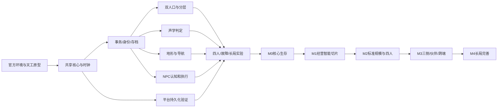

# 余烬边界：实施与验收计划 v1.0

日期：2026-11-11；引擎已确定为天工。本文定义未来开发的工作包和过关条件，**所有游戏测试当前均未执行**。本次仅检查文档完整性、规则一致性和需求追踪；不将架构审查等同于可运行产品验证。

## 1. 开发顺序

P0是技术风险验证，不是提前实现所有内容；例如只用一种材料和一种武器测试事务，只用简化表示测试31万/101万世界人口。四人技术握手可提前做，完整世界四人验收仍在M2。手机性能探索不能等到M3才第一次开始。

## 2. P0工作包

| ID | 工作包 | 输入与依赖 | 具体交付 | 过关条件/失败动作 |
| --- | --- | --- | --- | --- |
| P0-01 | 官方工具与天工表现原型 | 引擎已选；创建时确认平台与空目标目录 | 官方工程、版本锁、已读AGENTS/skills、固定相机、占位角色/地块、输入与暂停 | 官方check/build/预览通过；无猜测API；记录实际Node/pnpm/Engine/SDK版本 |
| P0-02 | 无渲染SimCore | 本方案协议；P0-01可与纯核实验解耦 | 时钟、ID、分系统随机、命令队列、只读投影、Worker/Node入口 | 相同逻辑代码两端可运行；核心无DOM/天工渲染/数据库依赖；暂停无时间流逝 |
| P0-03 | 身份/事务/存档最小闭环 | P0-02 | 两容器转移、制作、死亡、遗物、幂等、checkpoint与恢复 | 提交前后故障点全有/全无；重复命令不复制；死亡提交后不回退 |
| P0-04 | 双人口与空间表示 | P0-03 | 10000/99、日增、memberRanges、层级转换、安置与容量告警 | 3日例子39200/379正确；30/100日无暗删；队列与落位数可核对 |
| P0-05 | 声学参考实现与优化对照 | P0-02、地形最小模型 | 门墙路径传播、持续源、cohort细胞拆分、接收记忆 | 优化接收集合与展开参考零差异；静音/离屏声音一致 |
| P0-06 | 动态地形/导航 | P0-03 | 临时积水、永久陆桥断裂、修订、派生屏障、物品漂移 | 画面/碰撞/路径/位置一致；读档不退地形、不重复冲击 |
| P0-07 | NPC正式认知骨架 | P0-03、P0-05/06最小接口 | Belief、效用目标、HTN、同动作执行、预留、可解释日志 | 断粮/缺料/断路/风险四场景可完成或合理退出；没有真值后门 |
| P0-08 | 四人连接与权限实验 | P0-03；P0-01平台骨架 | 官方房间、固定永久绑定、4客户端、差量与重连 | 第5人拒绝；死亡重连不新建；双人同箱无复制；基线版本正确 |
| P0-09 | 造化服务端持久化证据 | 读取平台实际能力与合约 | 能力矩阵、延迟/配额/原子性/租约/重启证据 | 房间销毁重建后同worldId/死亡/日增可恢复；无证明则长期联机Gate不通过 |
| P0-10 | 设备与负载基线 | P0-01—08 | 指定PC、Android、iOS/浏览器或宿主的基准报告 | 记录设备/浏览器/画质/热状态/数据规模；FPS、tick、内存、网络、存储均有分位数 |

P0允许用内存存储进行算法实验，但必须标`ephemeral`；它不能通过P0-03持久化验收。Node本地文件实验也不能直接替代P0-09生产平台证据。没有独占写者保护时禁止多会话打开正式世界。

## 3. 前十个实施提交的建议拆分

这是按依赖排序的代码工作单，不是已经执行的Git提交。

1. 官方生成工程并记录工具版本、读取项目指令；只提交最小模板和合法元数据。
2. 新增共享数据schema、ID/单位、Clock/RNG及无引擎核心测试入口。
3. 新增命令校验、同步TxPlan、局部不变量和只读投影。
4. 新增持久端口、内存测试实现、IndexedDB候选实现、独占写者、恢复夹具。
5. 实现角色白板、两个容器、堆叠转移和一个长流程Job；补故障注入。
6. 实现死亡墓碑、遗物原物品转移、角色永久绑定和观战权限。
7. 实现chunk基础地形/差量、合法位置、占据最小模型和日增账本。
8. 实现感染体cohort/个体转换及声音参考传播，批量接收对照测试。
9. 实现NPC Belief/HTN/动作执行、资源预留和断路重规划；联调地形变化。
10. 接入官方多人骨架和平台持久适配验证，建立四人长局自动场景及基准看板。

平台能力调查从第1步就开始，不能等第10步才发现无持久存储。视觉原型/手机输入也从第1步建立，后续只映射核心投影。

## 4. GDD里程碑与完成标准

| 阶段 | 实现范围 | 必须保留的真实规则 | Gate |
| --- | --- | --- | --- |
| M0 随机世界与生存 | 沿海/沙丘/内陆样例，白板、声音、生存、物品和庇护施工 | 无初始营地；最小声音必听；真实资源；基本存档 | 首小时能探索、引尸、逃离、自建庇护；可复现种子与噪声风险 |
| M1 自主发展与地形切片 | 4名正式AI NPC、领导任务、有限弹药、禁刷、一只宠物、暴雨改路 | 不用专门脚本伪装智能；同规则执行与成本 | 断粮/缺料/断路/撤退成立；宠物身份连续；地形变更一致 |
| M2 世界与四人 | 99+100/日NPC、10000+10000/日感染体，大图、4人、基础演化、地形同步 | 数量和个人记忆不因扩量丢失；死亡重连正确 | 30日标准场景通过；100日压力报告；四人分岛/灾后加入/存档恢复 |
| M3 三侧与跨端 | 每侧独立战斗闭环、33技能、多宠物/骑乘、普通感染体改造、陆水交通、手机UI | 三侧不免费解锁/免消耗；共享预算；人类100生命 | 明确设备实机操作与性能；全流程供给/维护/死亡；第一轮路线平衡报告 |
| M4 完整灾害与长局 | 多灾难、全部分支、精英/特殊体、失控、多势力、高阶演化 | 容量/经济/智能/控制持续正确 | 多种子长局、灾害组合、恢复迁移与发布玩家包全部达到已定义标准 |

M0/M1的少量人口是受控实验。M2未通过前不得声称“已实现每天新增10000丧尸且长期稳定”。M3之前可以研究触屏，但不宣称手机发布达标。

## 5. 基准场景集

| 场景 | 配置 | 重点指标 |
| --- | --- | --- |
| BENCH-01 人口增长 | 无死亡对照，完整d=0/7/30/100，NPC保留个人计划 | 活人/群体/成员例外/待落位数，堆内存、GC、日切耗时 |
| BENCH-02 高频声音 | 5/40/120/150+格声源，门墙、风雨、持续机器、离屏工地 | 接收集合差异、传播p95/p99、积压年龄、反应延迟 |
| BENCH-03 四人分离 | 四个关注区、每人伙伴、高速穿块、共同库存 | 活跃chunk、tick、带宽、快照尺寸、延迟、版本冲突 |
| BENCH-04 灾害叠加 | 暴雨、陆桥断裂、区块边界洪水、NPC撤离 | 派生屏障时长、路径重算数、对象位置与死亡守恒 |
| BENCH-05 聚落经营 | 多个NPC组织、工位争抢、食水紧张、研究生产 | 计划成功率、等待上限、循环失败、库存/奖励是否合法 |
| BENCH-06 长期战斗 | 攻城、有限弹药、载具炮位、演化、改造体失控 | 真实消耗、伤亡来源、尸体/遗物增长、预算重算 |
| BENCH-07 存储压力 | 慢写、配额不足、checkpoint换代、日志尾部损坏 | 关键提交延迟、暂停正确性、恢复水位、无半事务 |
| BENCH-08 手机生命周期 | 热机15—30分钟、锁屏/切后台/来电/杀进程、网络切换 | FPS分位、内存峰值、保存确认、重连、输入误触 |

每个报告记录seed、rulesetHash、contentHash、buildId、Engine/SDK版本、CPU/GPU/RAM、系统、浏览器/宿主、分辨率、画质、网络模型、样本时长。报告含失败与模拟时间倍率；不能只报平均FPS。

## 6. 自动化与故障测试

### 6.1 分层测试

- 单元：需求、伤害、配方、资格、预算、位置合法、状态机迁移。
- 属性/随机测试：任意转移/拆合、捕获/改造/失控、层级转换、重复命令后数量不变；ID不重复、组织无环。
- 场景：固定地图和种子，行为目标有可检验成功与合理失败条件。
- 集成：Worker与Node共用核心，平台真实房间、多客户端、当前玩家包。
- 故障：提交点断开、双写者、乱序补片、损坏存档、设备后台与配额失败。
- 基准：分位耗时、内存与行为质量同时比较，防止优化偷偷改变规则。

### 6.2 必测故障点

| 编号 | 注入 | 必须看到的结果 |
| --- | --- | --- |
| F01 | 命令收到后、事务校验前断连 | 重发可正常执行一次 |
| F02 | 候选写集形成后崩溃 | 上个已提交状态仍完整，无半扣料 |
| F03 | 日志/快照分片写到一半中断 | 不引用不完整checkpoint；完整事务或无事务 |
| F04 | 提交完成但ACK丢失 | 查询/重试返回原结果，不再消耗 |
| F05 | 旧进程/标签页恢复并提交 | 旧writerEpoch被拒绝 |
| F06 | 死亡提交后重启、重连、尝试操控伙伴 | 仍死亡/观战，伙伴不可由死者控制 |
| F07 | 同时换座/装填/开火/上下骑 | 无重复命中、弹药或动作恢复重置 |
| F08 | 灾害分片重发、缺片、版本跳跃 | 不重复漂移/扣损；补全后再开放依赖操作 |
| F09 | 成品提交时工人死亡或工位被毁 | 有唯一确定先后，材料/产出不复制 |
| F10 | 配额满、存储慢、原子切换不可用 | 进入明确阻塞/能力不支持，不伪造保存成功 |
| F11 | 完成新一天后反复存读与批量落位重试 | 两类人口只增一次，personality/起步物资不重抽 |
| F12 | 占据边界与cohort升档同tick变化 | 使用同一当前修订，不在内部凭空生成 |
| F13 | all-dead与新玩家加入同tick | 固定事件排序，已结束世界不绑定新生命 |
| F14 | 新内容包删除/改名旧物品或技能ID | 显式迁移或拒绝加载，不静默删物资 |

故障恢复测试先覆盖可枚举提交点，再做固定种子的随机中断；次数和覆盖统计写入报告。本方案不把随意“跑100次”当作可靠性证明。

## 7. 项目Definition of Done

一个模块完成必须同时提交：

1. 数据schema、状态机和写权限；至少一个从合法到非法边界的测试。
2. 命令、事务、事件、幂等和存档恢复路径。
3. 在单人和Node中使用同一规则的证据。
4. 最小可读反馈与错误原因，支持电脑和触屏语义。
5. 代表性负载报告，注明未覆盖范围。
6. 对相关A编号逐项给出通过证据或明确未完成，不能用“基本支持”覆盖整组。

发布门槛额外包括官方天工check/build与造化玩家包校验、加载/生命周期、四人证据、持久化能力、真实设备和素材来源；`wired`、`verified`或一次截图都不是完整产品验收。

## 8. A01—A92需求追踪矩阵

以下逐条保留GDD第19节的测试描述与预期，增加责任域和阶段。`机制验证`表示允许小夹具提前测试；`正式验收`是对应产品范围应完整通过的最晚阶段。状态全部为**待实现/待测试**。

| 编号 | 原策划测试 | 原策划预期 | 责任域 | 机制验证 | 正式验收 |
| --- | --- | --- | --- | --- | --- |
| A01 | 给玩家升级、装备、食用高级食物 | 生命上限始终100 | 角色/声学/生成 | P0 | M0 |
| A02 | 在声学路径有效范围内制造最小声音 | 范围内丧尸收到事件，没有随机漏听 | 角色/声学/生成 | P0 | M0 |
| A03 | 墙后发声，分别开关门测试 | 传播范围按路径改变，丧尸不能隔墙攻击 | 角色/声学/生成 | P0 | M0 |
| A04 | 发声后安静离开原位置 | 丧尸先搜索旧声源，不读取新位置 | 角色/声学/生成 | P0 | M0 |
| A05 | 完成第3日且全部来源累计消灭800只 | 世界存活39200只；迁徙和演化不改变总数 | 人口/持久化/位置 | P0 | M2 |
| A06 | 清空区域后离开并重新进入 | 不因加载恢复旧人口；新出现者有每日新增或迁入账本来源，据点内部仍禁刷 | 人口/持久化/位置 | P0 | M2 |
| A07 | NPC建房与制造 | 库存、工时和物品结算正确，没有免费资源 | 经济/占据/NPC/任务 | P0 | M1 |
| A08 | NPC招募另一NPC，形成组织链 | 归属正确且没有环；被招募者仍有生存需求 | 经济/占据/NPC/任务 | P0 | M1 |
| A09 | NPC提出招募玩家 | 必须由玩家主动接受，不能接管操作 | 经济/占据/NPC/任务 | P0 | M1 |
| A10 | NPC死亡并重载存档 | 不复活；全部原装备保留可拾取 | 经济/占据/NPC/任务 | P0 | M1 |
| A11 | 宠物死亡并重载存档 | 原身份仍为死亡，骑乘与跟随资格消失 | 经济/占据/NPC/任务 | P0 | M1 |
| A12 | 4人共享容器，重复重连 | 不丢失或复制物品，第5名玩家不能进入 | 联机/席位/存档 | P0 | M2 |
| A13 | 联机角色死亡后重新连接 | 仍为死亡或观战，不得到新背包和生命 | 联机/席位/存档 | P0 | M2 |
| A14 | 房主保存退出并在数日现实时间后打开 | 默认暂停模式不追加离线丧尸或饥饿结算 | 联机/席位/存档 | P0 | M2 |
| A15 | 攻城接近并进入营地 | 先有可发现迹象，从实际路径进入，不在卧室瞬移生成 | 攻城/演化/气候/导航 | P0 | M2 |
| A16 | 手机放置建筑、开启机器与攻击 | 预览和确认清晰，危险行为不易误触 | 战斗/研究/载具/跨端 | P0或M1夹具 | M3 |
| A17 | 断电、制作中断、存档恢复 | 不重复扣材料，不重复生成成品 | 经济/占据/NPC/任务 | P0 | M1 |
| A18 | 四人分散、噪声集中与持续人口增长 | 记录明确设备上的帧率、延迟、内存与模拟一致性 | 联机/席位/存档 | P0 | M2 |
| A19 | 初始化正式世界并列出组织资产 | 初始营地和据点均为0，没有预建NPC领地或运营基地 | 角色/声学/生成 | P0 | M0 |
| A20 | 比较玩家、99名初始NPC与每日新增NPC模板 | 基础属性、初始技能知识、起步装备档次与生存状态一致，生命100、专业技能0级 | 角色/声学/生成 | P0 | M0 |
| A21 | 完成第3日并累计死亡20名NPC | 世界存活379名；每天100名新增者均有新身份，死者仍死亡 | 人口/持久化/位置 | P0 | M2 |
| A22 | 同一天重复保存、读档与重连 | 不重复执行NPC和丧尸日增，不漏记合法新增 | 人口/持久化/位置 | P0 | M2 |
| A23 | 检查所有初始与新增NPC档案 | 每人有性格、个人目标、持续记忆与独立身份，不存在无性格批次 | 人口/持久化/位置 | P0 | M2 |
| A24 | 在已有丧尸的旧屋尝试直接占领 | 不清空或删除原敌人；满足清理和实际建设条件后才形成有效据点 | 经济/占据/NPC/任务 | P0 | M1 |
| A25 | 对已占据据点测试普通、事件、重载与群体转实体生成 | 均不在内部凭空出现新敌人；无效位置移至外部且保留新增数量 | 经济/占据/NPC/任务 | P0 | M1 |
| A26 | 敌对尸群从外部抵达已占据据点 | 可沿实际路径进入或破门，保护不阻止真实攻城 | 经济/占据/NPC/任务 | P0 | M1 |
| A27 | 只画蓝图、放空旗或离开据点 | 空圈地不获得无限保护；已有效占据据点不因暂时无人立即失效 | 经济/占据/NPC/任务 | P0 | M1 |
| A28 | 无营地领袖发布第一条建设与收集任务 | 可建立任务，预算和前置依赖可检查；无需凭空生成高级基地 | 经济/占据/NPC/任务 | P0 | M1 |
| A29 | 重复交任务、取消任务及领袖死亡 | 验收对应实物或建筑，预留物资正确处理，奖励不复制 | 经济/占据/NPC/任务 | P0 | M1 |
| A30 | 给NPC设置即将断粮、工地缺料与阻路场景 | 会安排补给、拆分任务、协作或换路，并保留理由与计划记录 | 经济/占据/NPC/任务 | P0 | M1 |
| A31 | 验证不同性格NPC遭遇同一危险 | 权衡与策略不同，但均能评估风险、寻找路径和调整计划 | 经济/占据/NPC/任务 | P0 | M1 |
| A32 | 将NPC卸载、远距模拟后再次接近 | 计划、库存、关系、学习与记忆连续，没有免费发展或智能重置 | 经济/占据/NPC/任务 | P0 | M1 |
| A33 | 弹药为空时让玩家、NPC、车载与自动武器射击 | 均不能有效发射；补充只来自真实兼容弹药或载荷 | 战斗/研究/载具/跨端 | P0或M1夹具 | M3 |
| A34 | 对装填、射击、换座、改装和读档进行交叉操作 | 弹药、能源和部件数量守恒，无自动补满或重复制造 | 战斗/研究/载具/跨端 | P0或M1夹具 | M3 |
| A35 | 在小型底盘上超量安装装甲与武器 | 按安装位、载重、动力和供能规则拒绝或明确提示后果 | 战斗/研究/载具/跨端 | P0或M1夹具 | M3 |
| A36 | 使用不同种子和不同局内行为运行演化测试 | 分支受本局事件、个体与区域条件影响，不是纯日期固定解锁 | 攻城/演化/气候/导航 | P0 | M2 |
| A37 | 对单个敌人制造演化压力并观察 | 记录积累与阶段过程，不导致全地图瞬间免疫或死者复活 | 攻城/演化/气候/导航 | P0 | M2 |
| A38 | 对变异动物与植物改变环境和互动 | 按各自物种分支演化，并保持身份、数量来源和禁刷规则 | 攻城/演化/气候/导航 | P0 | M2 |
| A39 | 智慧型或超能敌人接近据点 | 依据已知信息和实际动作进攻，不透视、不凭空生成、不绕过声音规则 | 攻城/演化/气候/导航 | P0 | M2 |
| A40 | 从白板分别推进三条科技路线 | 均通过材料、知识、设施与时间完成，不共享未交换的势力研究 | 战斗/研究/载具/跨端 | P0或M1夹具 | M3 |
| A41 | 使用现代、生化或基因改造提升角色 | 人类生命上限仍100，无复活和无代价无限弹药或能源 | 战斗/研究/载具/跨端 | P0或M1夹具 | M3 |
| A42 | NPC领袖自主组织建造、研究和载具生产 | 能产生前置任务、调配实际库存与工时，并在受阻时重新规划 | 战斗/研究/载具/跨端 | P0或M1夹具 | M3 |
| A43 | 使用不同种子生成沿海、沙丘和内陆样例 | 主地貌、过渡区、资源、水系和气候参数连贯，同种子可复现 | 角色/声学/生成 | P0 | M0 |
| A44 | 在不临海的内陆世界评估灾害候选 | 不无来源生成海洋海啸，相关水灾按实际水系和事件定义 | 灾害/水文/演化 | P0 | M4 |
| A45 | 生成平稳、高温和严寒气候局 | 正常天气真实可出现，异常可持续多日，生存与生产规则相应改变 | 攻城/演化/气候/导航 | P0 | M2 |
| A46 | 暴雨导致积水并最终退水 | 画面、水深、碰撞、泥泞、路径和伤害一致，临时与长期变化分开 | 地形/占据/遗物 | P0 | M1 |
| A47 | 龙卷风经过林地、建筑与物资 | 按实际事件范围结算对象和通路状态，离屏和重载后仍保持结果 | 灾害/水文/演化 | P0 | M4 |
| A48 | 地震改变标高、桥路和建筑状态 | 寻路与结构同步变化，余震按事件状态执行，不在读档后无故复原 | 灾害/水文/演化 | P0 | M4 |
| A49 | 海啸仅产生临时淹没而无长期地貌变化 | 水位回落后符合条件的陆地重新露出，不无条件永久涨海 | 灾害/水文/演化 | P0 | M4 |
| A50 | 海啸与侵蚀或沉降切断低地陆桥 | 原连续陆地成为岛屿，退水后新海岸线与陆地连通区保留 | 灾害/水文/演化 | P0 | M4 |
| A51 | 原路线被淹没或断裂后继续下达移动任务 | 步行、车辆和NPC重新判断能力，不沿隐形旧路跨海或穿越塌陷 | 攻城/演化/气候/导航 | P0 | M2 |
| A52 | 四名玩家在不同区域经历地貌变化并重连 | 权威地形、路径、对象位置和事件阶段一致，中途加入同步当前世界 | 联机/席位/存档 | P0 | M2 |
| A53 | 在灾害中及灾后保存读档 | 同一冲击、漂移和扣损不重复执行，已记录的地形不回退 | 联机/席位/存档 | P0 | M2 |
| A54 | 洪水或塌陷影响已占据据点 | 仍按有效归属和新地形执行禁刷，无静默清空占据和凭空刷怪 | 地形/占据/遗物 | P0 | M1 |
| A55 | NPC获得可信灾害信息且拥有可用准备时间 | 能评估地势、物资和交通，安排加固、迁移、人员动物转移或救援 | 灾害/水文/演化 | P0 | M4 |
| A56 | 建设或收集目标因灾害不可达 | 任务重新规划、申请交通或报告调整，不机械冲入危险旧目标 | 攻城/演化/气候/导航 | P0 | M2 |
| A57 | 灾害使NPC或宠物死亡并移动遗物 | 死亡不逆转，遗物身份、原装备清单和位置状态持续保存 | 地形/占据/遗物 | P0 | M1 |
| A58 | 地形变化后执行每日新增 | NPC和丧尸按当前合法地形与据点边界生成，日增账本不重复或静默减少 | 人口/持久化/位置 | P0 | M2 |
| A59 | 灾害造成丧尸与NPC真实死亡 | 两套人口公式包含环境死亡，迁移、漂流和卸载不冒充死亡 | 人口/持久化/位置 | P0 | M2 |
| A60 | 分别只推进每侧基础战斗分支 | 科技、生化、改造均有独立直接战斗产出，不强制完成另一侧高阶树 | 战斗/研究/载具/跨端 | P0或M1夹具 | M3 |
| A61 | 选择三侧各自不同专业分支 | 成长前置、资源、设施和战斗方式有所区别，不能只换名称共用全部内容 | 战斗/研究/载具/跨端 | P0或M1夹具 | M3 |
| A62 | 白板角色开始研究或选择路线 | 不免费获得技能满级、现成营地、高级装备或其他未研究分支 | 战斗/研究/载具/跨端 | P0或M1夹具 | M3 |
| A63 | 使用三侧武器、战兽或主动能力 | 弹药、载荷、培养物、能源、营养与维护实际结算，没有无限免费产出 | 战斗/研究/载具/跨端 | P0或M1夹具 | M3 |
| A64 | 使用义体、药剂、基因能力与恢复后保存重连 | 人类生命上限仍100，死亡不复活，不通过隐藏生命或模块切换绕过规则 | 战斗/研究/载具/跨端 | P0或M1夹具 | M3 |
| A65 | 三侧分别遭遇高温、寒冷、积水与岛屿化 | 各有可争取的研究、操作或合作方案，适应能力仍有代价，不获得完全免疫 | 战斗/研究/载具/跨端 | P0或M1夹具 | M3 |
| A66 | 不同性格和资源条件的NPC独立发展 | 可形成不同路线与战斗组织方式，不全知复制玩家的隐藏装备选择 | 战斗/研究/载具/跨端 | P0或M1夹具 | M3 |
| A67 | 局部灾害改变温度、水体与食物分布 | 演化压力只影响实际暴露与有记录的对象，不瞬间改造全世界 | 灾害/水文/演化 | P0 | M4 |
| A68 | 旧陆路被切断且没有高阶科技 | 有可争取的基础材料、知识与交通或替代生存链，不因研究死锁必死 | 战斗/研究/载具/跨端 | P0或M1夹具 | M3 |
| A69 | 创建玩家、初始NPC和日增NPC并检查技能表 | 总共33项技能，驯兽初始为0，没有赠送宠物、改造体或控制研究 | 伙伴/控制/骑乘/人口 | M1夹具 | M3 |
| A70 | 培养多宠物并达到不同驯兽等级 | 培养名额和指挥点按已解锁条件变化，训练经验不能靠重复喂食无限复制 | 伙伴/控制/骑乘/人口 | M1夹具 | M3 |
| A71 | 同时解锁驯兽与生化控制后编队 | 共享预算取已解锁较大值、不直接相加，单位数、种类和资格同时检查 | 伙伴/控制/骑乘/人口 | M1夹具 | M3 |
| A72 | 骑乘大型宠物并带其他随行单位 | 坐骑只计一次且不能免费，驾驶、驯兽、鞍具、健康与预算均成立 | 伙伴/控制/骑乘/人口 | M1夹具 | M3 |
| A73 | 骑乘中攻击、受伤和坐骑死亡 | 命中、体力和有限弹药分别结算，人物上限100，不通过上下骑复制攻击或复活 | 伙伴/控制/骑乘/人口 | M1夹具 | M3 |
| A74 | 指令宠物牵制、护卫和撤退并阻断通路 | 能执行已训练职责并合法改路或报告，风险和不服从原因可读 | 伙伴/控制/骑乘/人口 | M1夹具 | M3 |
| A75 | 宠物转交队友、回营、读档或死亡 | 保留身份、训练、关系和真实位置，不复制、不瞬移、不复活 | 伙伴/控制/骑乘/人口 | M1夹具 | M3 |
| A76 | 主人死亡或断线后尝试继续发出指令 | 观战者不能作战；接管方满足资格、范围和预算，不恢复死者操作 | 伙伴/控制/骑乘/人口 | M1夹具 | M3 |
| A77 | 研究感染体改造并开始生产 | 必须捕获世界已有未消灭目标并支付工位、材料与工时，不凭菜单生成 | 伙伴/控制/骑乘/人口 | M1夹具 | M3 |
| A78 | 对已消灭丧尸或死亡NPC宠物进行改造尝试 | 不恢复原体，不借研究、修复或重新绑定实现复活 | 伙伴/控制/骑乘/人口 | M1夹具 | M3 |
| A79 | 取消、中断、失败或重复提交改造 | 已耗资源和伤势持续，未用物资按阶段处理，不全额返还或复制核心 | 伙伴/控制/骑乘/人口 | M1夹具 | M3 |
| A80 | 在各控制阶段保有并部署普通、精英和特殊体 | 总保有量、同时出战、种类限制和2/4/6点占用共同生效 | 高阶改造/稳定性/演化 | M1或M3夹具 | M4 |
| A81 | 选择能力保留方案并查看结果 | 改造前显示损失，百分比用于对应进化增益，不随机删除或读档重抽能力 | 高阶改造/稳定性/演化 | M1或M3夹具 | M4 |
| A82 | 使用改造体的远程与特殊能力 | 范围、冷却和真实载荷消耗成立，不复制身体、无限攻击或全图透视 | 高阶改造/稳定性/演化 | M1或M3夹具 | M4 |
| A83 | 降低稳定性、能源和维护并恢复 | 风险逐步提示，按策略降载或隔离，掉电不瞬间满血敌对，应急有真实消耗 | 高阶改造/稳定性/演化 | M1或M3夹具 | M4 |
| A84 | 改造体失联且返回路径被海水或塌陷阻断 | 执行可行应急策略，不能瞬移或沿水下旧路移动 | 伙伴/控制/骑乘/人口 | M1夹具 | M3 |
| A85 | 捕获1只、改造1只，再真实消灭该个体 | 捕获与改造时总人口不变，实际死亡只扣一次，NPC人口不受改造状态影响 | 伙伴/控制/骑乘/人口 | M1夹具 | M3 |
| A86 | 受控体发声并攻击自由丧尸 | 声音照常被接收，自由丧尸可反击，不提供无风险清图或主人隐身 | 伙伴/控制/骑乘/人口 | M1夹具 | M3 |
| A87 | 改造体积累新的演化压力 | 保留记录并复检研究和预算，不免费解锁超限能力或重置消耗 | 高阶改造/稳定性/演化 | M1或M3夹具 | M4 |
| A88 | 将宠物或改造体标记备用、休息或驻守 | 需要真实空间和供给，主动任务占用对应岗位，不以标签获得无限免费守卫 | 伙伴/控制/骑乘/人口 | M1夹具 | M3 |
| A89 | 控制者死亡、单位失控、转交并反复重连 | 唯一实体、控制者、状态和预算一致，不掉落或生成多个副本 | 伙伴/控制/骑乘/人口 | M1夹具 | M3 |
| A90 | 反复保存并读取同一改造方案 | 原身份、保留能力、稳定性、成本和伤势一致，不重新抽取更优结果 | 伙伴/控制/骑乘/人口 | M1夹具 | M3 |
| A91 | NPC自主发展驯兽或生化控制 | 从白板学习、建造、获取目标和维护，使用与玩家相同规则，不离屏免费成军 | 伙伴/控制/骑乘/人口 | M1夹具 | M3 |
| A92 | 四人带多种随行单位并在手机发撤退指令 | 个人与组队部署正确，目标选择、骑乘和群体撤退清晰，记录实际设备性能 | 伙伴/控制/骑乘/人口 | M1夹具 | M3 |

A44、A48、A50等地貌资格与连通变化的最小技术实验必须在P0/M2提前证明；表中的M4指完整多灾害内容，并不允许把核心可行性延后。A33等有限弹药在M1已经用于普通武器，M3再扩展到车载、自动与三侧载荷。
