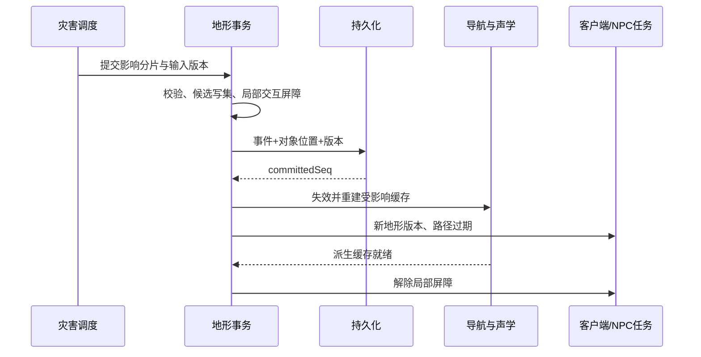

# 余烬边界：数据与协议契约 v1.0

日期：2026-11-11；配套《游戏底层架构方案-v1.0》。本文是待实现的内部接口规范。下列TypeScript是说明结构的伪接口，不是已编译的SDK调用，不替代天工与造化实际安装版本的官方接口。

## 1. 类型、单位和身份

- `WorldId / EntityId / ItemId / JobId / EventId / CommandId`为不同语义的ID，接口层使用品牌类型避免混用。
- 持久ID永不复用；64位ID以十进制字符串或两个32位整数编码，JSON不直接放BigInt。
- 地块坐标与渲染坐标分离。建议位置用`1/256格`定点；质量用克、液量用毫升、能量用游戏定义的整数单位、时间用tick。范围及溢出断言写入schema。
- 游戏日长度是ruleset中的tick数；默认20Hz、30分钟/日时为36000tick/日，属测试参数。`completedDays=floor(simTick/ticksPerDay)`仅在日切提交边界推进，出生时displayDay=1。
- 固定生命100是规则而非可写maxHP属性。生命可采用整数定点保存例如10000表示100.00，必须在显示与伤害中统一单位，不把10000误报为上限10000。
- 随机流按系统分离，保存流状态或计数。关键事件记录已选结果，恢复不得再抽一次。

```ts
type EntityId = string;
type Revision = number; // 范围检查；不能无限递增而不处理精度边界
type Tick = number;
type Vec2Q = { xQ: number; yQ: number };
type WorldHeader = {
  worldId: string;
  schemaVersion: number;
  simVersion: string;
  generatorVersion: string;
  contentHash: string;
  rulesetId: string;
  rulesetVersion: number;
  seed: string;
  tick: Tick;
  completedDays: number;
  committedSeq: string;
  checkpointSeq: string;
  writerEpoch: string;
  phase: 'Running' | 'Paused' | 'DayBoundary' | 'Recovering' |
         'CapacityBlocked' | 'PersistenceBlocked' | 'Ended';
};
```

权威状态只允许纯数据和ID引用。禁止Promise、闭包、生成器、定时器句柄、场景对象、以对象地址为意义的映射、不可序列化的规划栈。可使用Map作为运行时索引，但持久化编码必须确定且有schema；索引不得成为唯一事实来源。

## 2. 核心记录

| 记录 | 必备字段 | 持有者/关键约束 |
| --- | --- | --- |
| Character | id、kind、startTemplateVersion、lifeState、position、needs、skill、knowledge、inventoryId、factionId | Actor；人类maxHP固定，玩家/NPC同模板 |
| NPCProfile | personalitySeed、维度、偏好、personalGoals、beliefs、memories、plan、nextThinkTick | Cognition；全部NPC永久身份 |
| Item/Stack | id、definitionId、quantity、batch、durability、condition、location、revision、provenance | Inventory；唯一位置、非负数量 |
| Container | id、位置状态、容量、权限、slots、revision | Inventory；不能以UI合并库存取代运输 |
| Building | id、blueprintId、footprint、owner、progress、投入、condition、functionalState、revision | Settlement；升级保留id和库存 |
| Occupation | id、anchorId、factionId、有效范围、validatedTerrainRev、state、失效原因 | Settlement；范围来自实际建设和清理 |
| Task | id、publisher、目标、输入预算、交付条件、风险/撤退、assignees、state、settlementId | Work；验收实物、奖励幂等 |
| Reservation | id、resourceRef、amount、holder、jobId、expiryTick、revision | Economy；延期/取消/死亡均需处理 |
| PopulationLedger | initial、dailyCreated、deaths、alive、placed、pending、lastCommittedDay | Population；两个人口池独立 |
| Cohort | id、populationClass、memberRanges、count、cells、route、arrivalTick、traits、exceptions、revision | Population；成员集合不与个体重叠 |
| Companion | entityId、owner/caretaker/controller、training、deployment、controlCost、equipment、revision | Control；财产与有效控制分开 |
| Modification | targetId、captureEvent、planVersion、retainedTraits、成本、stability、设备、维护、history | Control；同一存续感染体 |
| Disaster | id、type、eligibility、seed/随机状态、phase、stageTick、affectedChunks、appliedBatches | Disaster；阶段幂等 |
| DeathTombstone | entityId、deathEventId、tick、cause、commitSeq、lootContainerId | Identity；与遗物/人口同事务 |
| CharacterBinding | worldId、seatId、platformPlayerId、characterId、state、boundSeq | Session；死亡绑定不可重置 |

### 2.1 物品位置判别联合

```ts
type ItemLocation =
  | { kind: 'Container'; containerId: EntityId; slotId: string }
  | { kind: 'Equipment'; actorId: EntityId; slotId: string }
  | { kind: 'JobInput'; jobId: string; slotId: string }
  | { kind: 'World'; chunkId: string; position: Vec2Q }
  | { kind: 'Magazine'; weaponId: EntityId; channel: string }
  | { kind: 'Consumed'; eventId: string }; // 审计终态，非可拾取库存
```

关系字段不能同时多写。例如一次装填不是原背包数量减后再异步弹匣加，而是一个事务更新两侧与版本。遗物是Container，不能再复制一个包含同物品ID的独立掉落数组。

### 2.2 地形版本记录

```ts
type TerrainChunk = {
  id: string;
  generatorVersion: string;
  baseHash: string;
  terrainRevision: Revision;
  structureRevision: Revision;
  elevationDeltaQ: Int32Array;
  waterDepthQ: Uint16Array;
  surfaceFlags: Uint16Array;
  materialIndex: Uint16Array;
  permanentPatchRefs: string[];
};
type DerivedChunkStatus = {
  terrainRevision: Revision;
  navRevisionByMode: Record<string, Revision>;
  acousticRevision: Revision;
  connectivityRevision: Revision;
  ready: boolean;
};
```

真实类型化数组宽度由范围基准确定，以上不承诺最终字节布局。洪水变更不仅更新`waterDepthQ`，还产生对应结构/物品/生命结果；派生未就绪时保守阻挡，不能沿旧路径继续。

### 2.3 声音与群体成员

```ts
type SoundEvent = {
  eventId: string; sourceId?: EntityId; tick: Tick;
  sourcePosition: Vec2Q; sourceChunkId: string;
  soundDefId: string; propagationBudget: number;
  durationTicks: number; acousticRevision: Revision;
};
type CohortSpatialCell = {
  cellId: string;
  memberRanges: Array<{ first: string; count: number }>;
  placementSeed: string;
  occupancyRevision: Revision;
  capacity: number;
};
```

成员区间只是身份压缩，不等于一格无限堆叠；细胞必须有可兑现的容量和确定位置规则。声音传播范围部分覆盖时拆分细胞/成员，不能以中心点一次判全群。层级转换交接待处理声音集合或已覆盖序号区间；单一`lastSoundSeq`只有在严格有序无遗漏时才安全，乱序/分片时应使用去重窗口与未完成列表。

## 3. 命令与回应合同

```ts
type CommandEnvelope<T> = {
  protocolVersion: number;
  worldId: string;
  commandId: string;
  sessionEpoch: string;
  clientSequence: number;
  actorId: EntityId; // 服务端须与会话绑定核对
  expectedVersions: Record<string, Revision>;
  kind: string;
  payload: T;
};
type CommandResult =
  | { ok: true; commandId: string; committedSeq: string; events: string[] }
  | { ok: false; commandId: string; code: string; retryable: boolean;
      currentVersions?: Record<string, Revision>; detailKey?: string };
```

| 命令 | 必要校验 | 同一提交内的写集 |
| --- | --- | --- |
| TransferItem | 活人/权限/距离/数量/容量/预留/双方版本 | 源、目标、item位置与版本、事件 |
| FireAbility | 存活/动作窗口/消耗/射界/友伤/地形版本 | 资源扣除、动作、投射体/命中、噪声、伤害提议 |
| PlaceBlueprint | 范围/地形/占地/权限/基础资格 | 蓝图id与前置；不免费形成建筑或占据 |
| ContributeToJob | 工位/材料可访问/实际劳动/当前阶段 | 工时、投入/消耗、进度；完成时唯一产出 |
| PublishTask | 发布者权限/预算/目标有效 | 任务、奖励预留、依赖 |
| AcceptTask | 自愿/资格/风险/冲突 | 执行者分配、资源/岗位预留 |
| DeployCompanion | 独占控制/资格/距离/名额/指挥点 | 部署、预算、岗位、命令状态 |
| TransferControl | 双方同意/资格/范围/版本/存活 | 原控制释放、新控制绑定、双方预算 |
| Mount | 驾驶/驯兽/鞍具/健康/体型/容量/动作 | 座位租约、附着关系；不改变生命池 |
| CommitModification | 存续目标/研究/资源/阶段/能力方案 | 原体状态、已付成本、控制、人口分类 |
| RequestWorldPause | 单人或所有活人同意/安全/无待提交 | pauseVote、worldPhase；不由任一客户端直接停钟 |
| EndSession | worldOwner权限/有存储能力 | 保存水位、世界状态、角色绑定；不清空死亡 |

外部玩家命令与权威内部命令必须有不同白名单。玩家可请求开始改造、选择方案或贡献劳动，但`CommitModification`、完成生产、日增和确认死亡仅由权威调度器生成，不能让客户端请求跳过工时直接完成；即使命令名相同也不能信任客户端声明system身份。

拒绝结果也需对当前请求稳定可重放。版本冲突后UI刷新投影、使用新commandId重试，不以同ID修改负载。去重窗口可以压缩，但持久业务唯一键（死亡、日增、奖励、改造结果）不随短期网络窗口过期而可再次生效。

## 4. 事务协调与持久化

### 4.1 端口职责

```ts
interface SimulationKernel {
  plan(snapshot: ReadonlyWorld, command: ValidatedCommand): TxPlan | Rejection;
  apply(snapshot: ReadonlyWorld, plan: TxPlan): CandidateState;
  step(snapshot: ReadonlyWorld, tick: Tick): TxPlan[];
}
interface PersistencePort {
  probe(): Promise<StorageCapabilities>;
  acquireWriter(worldId: string): Promise<WriterLease>;
  commit(batch: CommitBatch, writer: WriterLease): Promise<CommitAck>;
  load(worldId: string): Promise<RecoveryBundle>;
  writeCheckpoint(checkpoint: Checkpoint, writer: WriterLease): Promise<void>;
}
```

`ReadonlyWorld`等符号只是结构占位，接口实现时单独定义。`plan/apply/step`不await、不做I/O；application层等待持久提交期间串行保留该世界队列。P0采用K=0推测窗口：该批确认前不推进后续权威tick；存储延迟计入性能预算，客户端只做允许的表现预测。所有异步计算结果回到命令队列后再核对版本。

推荐实现：同步构建写集和候选状态 -> 检查局部不变量 -> 持久适配器写批与提交标记 -> 确认writerEpoch仍有效 -> 原子替换已提交状态引用 -> 发布确认。若采用先更新工作副本后异步写盘，工作副本不可成为客户端可确认事实，且不能继续以它结算下一批不可逆行为。

### 4.2 提交批格式

```ts
type CommitBatch = {
  worldId: string; writerEpoch: string;
  prevSeq: string; nextSeq: string;
  batchId: string; commandIds: string[];
  events: DomainEvent[]; randomOutcomes: unknown[];
  statePatch: unknown; checksum: string;
};
type CommitAck = {
  batchId: string; committedSeq: string; writerEpoch: string;
  durability: 'transaction-complete' | 'backend-durable';
};
```

只把后台实际提供的保证写在Ack，不以字段名“durable”伪造介质持久性。存档既可使用“已决定事件重放”，也可用版本化状态patch，但必须选择并版本化唯一恢复路径，防止既应用事件又应用patch重复扣料。本方案选择完整权威statePatch作为恢复事实，领域事件用于审计与表现；恢复只应用patch一次，不再调用事件业务处理器。patch覆盖自上个提交边界以来所有权威变化，包括tick、位置、随机流、计划/调度和资源；不能只补死亡相关对象而留下其他对象停在旧快照。

### 4.3 不允许继续的失败

- 校验失败：无写入，返回稳定拒绝。
- 纯应用异常：丢弃候选状态，进入Faulted，不在半改内存上继续。
- 持久写失败：保持上个committedSeq，停止关键推进，有限退避重试相同batchId。
- 提交成功但确认丢失：查询batchId/seq，返回已提交结果，不再次消耗。
- 校验和不符：区分未提交尾部与已提交损坏。前者可以舍弃，后者阻塞恢复并诊断；不能逐条截断一个已经提交的跨物品/死亡事务。
- 旧写者返回：存储端拒绝较小writerEpoch，不能只在应用内自觉检查。
- 不变量失败：停止并导出诊断，不能自动改人口数字“对齐公式”。

### 4.4 独占写者与分叉

浏览器用受支持的独占锁机制，加IndexedDB事务内writerEpoch验证。租约心跳只有在条件写/事务原子性成立时才可接管；单纯“读时间再写租约”会产生双写，不能采用。联机的写者租约由后端支持的条件写/fencing保证，不假定Node锁文件跨进程、跨机器或重启仍可靠。

同一存档第二标签页默认只读或拒绝；旧标签页恢复前必须重新验证epoch。单人世界转联机属于后续显式迁移：源端提交`MigratedOut`并只读，目标端确认新epoch与相同世界清单；离线复制仍可能产生外部分叉，不能承诺防止用户手工备份回滚。

## 5. 五个关键端到端事务

### 5.1 同时开箱

A、B都读取容器revision=10。A转出物品提交revision=11；B携带expected=10失败，刷新后按当前余量再提交。B超时重发同ID返回原拒绝/成功，不能以重发数量再扣一次。任何UI预测都不能让另一客户端拾取尚未提交的产物。

### 5.2 跨日

1. 在日切前预计算候选安置与容量，保存可恢复计划，不提前增加可操作人口。
2. 到日边界进入屏障；唯一日键提交新增额度、成员ID/人格种子、待落位批与新的completedDays。
3. 分片完成合法落位；在标准模式中，待落位队列清空前不推进正常游戏时间。分片计算可跨多个现实帧，不能跨越长段游戏时间让大量“活人”不模拟。
4. 若无合法空间，停在`CapacityBlocked`，保留所有数量与工作结果，明确说明原因。若日增尚未提交则d不增加；已提交则pending可见并保持屏障，不能将已提交数量删回。
5. 恢复从日键和落位批继续，不重新生成性格/物资或增发。

真实地图外迁入世界是未来可选规则，需要外部区域、交通、需求和声音边界模型；本版本不通过无限冻结的“在途人口”冒充已完成增长。

### 5.3 死亡与抢遗物

致死命中与其消耗有因果关联；死亡批写墓碑、扣人口、原物品转移、控制释放和席位状态。提交前遗物不可领取；提交后多玩家拾取沿用容器版本。若批已提交而连接中断，重连首先恢复死亡/遗物，再开放观战。不得为了先显示流畅动画而提前发放可交易掉落。

### 5.4 地形分片提交



屏障期间允许与该区域无关的已知安全活动，不能用旧通行图承诺穿越。涉及区域的既有角色按已提交状态受水/伤害规则约束；“屏障”不能变成免伤保护罩。

### 5.5 感染体捕获、改造、失控

捕获前`free=F, restrained=R, controlled=C`；捕获后`F-1,R+1,C`；改造完成后`F-1,R,C+1`；失控后`F,R,C`（该对象回自由，仍同ID）；真实死亡才使总alive减1且death加1。每次转移同事务维护状态和人口分类。改造体临时离开通信范围不自动判“死亡”或新增自由副本。

## 6. 计划、预留与角色状态机

### 6.1 NPC计划

```ts
type PlanRecord = {
  planId: string; goalId: string; actorId: EntityId;
  beliefVersion: number;
  steps: Array<{ actionDefId: string; args: unknown; state: string }>;
  cursor: number;
  dependencies: Array<{ kind: string; id: string; revision: number }>;
  reservations: string[];
  failedAttempts: Array<{ code: string; tick: Tick; targetId?: string }>;
  nextEvaluationTick: Tick;
  retreatConditionId: string;
};
```

实际执行使用World真值校验，规划仅用Belief。路径被淹没产生`DependencyInvalidated`，停旧步骤、撤销不再需要的预留，选择绕行/运输/请求修改；不能把目标坐标存在当作任务可执行。

### 6.2 角色与连接分离

```text
CharacterBinding: Unbound -> Alive -> Dead    （死亡终态）
Connection:        Disconnected <-> Handshaking -> Syncing -> Active
Control:           PlayerInput -> DefensiveAutopilot -> Sheltered/Waiting
World:             Running <-> Paused -> Ended
```

连接断开不直接把Alive变Dead或Unbound。一个绑定同时只有一个有效sessionEpoch，旧连接命令拒绝。观战不进入PlayerInput。停止房间不删除永久绑定。只剩观战者的推进策略使用规则表，不由平台连接人数直接决定。

## 7. 网络快照与差量

### 7.1 握手

```ts
type Hello = {
  protocolVersion: number; buildId: string; simVersion: string;
  contentHash: string; rulesetHash: string;
  requestedWorldId: string; lastAckSeq?: string;
};
type WorldBaseline = {
  worldId: string; baselineId: string; committedSeq: string;
  actorBinding: unknown; worldClock: unknown;
  requiredChunks: Array<{ id: string; revision: number; hash: string }>;
  visibleEntities: unknown[]; authorizedViews: unknown[];
};
type StateDelta = {
  baselineId: string; fromSeq: string; toSeq: string;
  chunkPatches: Array<{ id: string; fromRev: number; toRev: number; patch: unknown }>;
  entityChanges: unknown[]; presentationEvents: unknown[];
};
```

Hello不携带可自证的账号或最终角色状态；身份来自官方服务端上下文。角色绑定状态必须在任何背包/控制输入前确认。玩家从未获知的区域只给必要抽象情报，不发送隐蔽实体供客户端自行隐藏。

### 7.2 背压和恢复

大基线分片包含manifest、片序、总片数、校验；缺片可以重传，完整通过后ACK。服务器在基线期间保存后续差量窗口；窗口超出就重建新基线，不无限占内存。常规世界状态在版本满足时应用，过期/乱序/不认识baseline就拒绝并请求补齐。

分片大小从16—64KiB测量起，低于平台当前1MiB帧上限；不宣称该范围已是最佳值。JSON先验证协议，人口/地形热点再评估二进制，不要求首日自造全套压缩协议。ACK、重连和幂等不能依赖某个二进制库。

自身移动预测复用纯移动规则及权威地形版本；纠正时回放未确认输入。其他角色/伙伴插值，绝不依赖客户端预测改变伤害、库存或死亡。动画事件按eventId去重，重连不重新播放整局爆炸/改造效果。

## 8. 版本与迁移

分别管理：存档schema、内容包、模拟规则、地图生成器、网络协议、引擎版本。修改其中一个不自动升级其他所有版本。

迁移：读取旧manifest -> 完整备份 -> 迁移到新槽 -> 校验所有稳定ID/数量/死亡/引用 -> 提交新manifest -> 原文件保留只读。未知内容ID不能静默删物品；使用显式兼容映射或阻止加载。地图生成器改变时旧世界固定旧生成结果或提供迁移，不直接用新种子算法覆盖玩家地貌。

单人/Node跨环境恢复优先验证事件应用结果一致；固定版本同环境继续运行测试才要求状态哈希一致。跨运行环境的超越函数、引擎物理和执行时序不能被当作天然逐位确定。

## 9. 必须加入的自动检查

- 快照序列化往返无权威字段丢失；定点/ID无精度损失。
- 每类关键事务在写前、部分写、提交标记前、提交后确认前、确认后崩溃，恢复只有全有或全无。
- 事务正文禁止I/O、await、未注入随机/时间，规划器禁止导入World真值。
- 每个活体成员恰属一个表示；每件未消耗物品恰属一个位置；每个伙伴至多一个控制者。
- 全局深入审计在测试/巡检运行；发布每次提交至少检查写集涉及的不变量，不能只等每日审计才发现负库存或复活。
- 旧writerEpoch写入、重复commandId不同负载、旧chunkRevision输入、死亡角色命令都被拒绝。
- 所有错误有明确码与可复现诊断；不以自动修改存档绕过失败。
- checkpoint使用固定提交序号下的不可变页/COW视图；持久化日志包括两个checkpoint之间的连续状态变化，恢复后关键事件与位置同一时刻。
