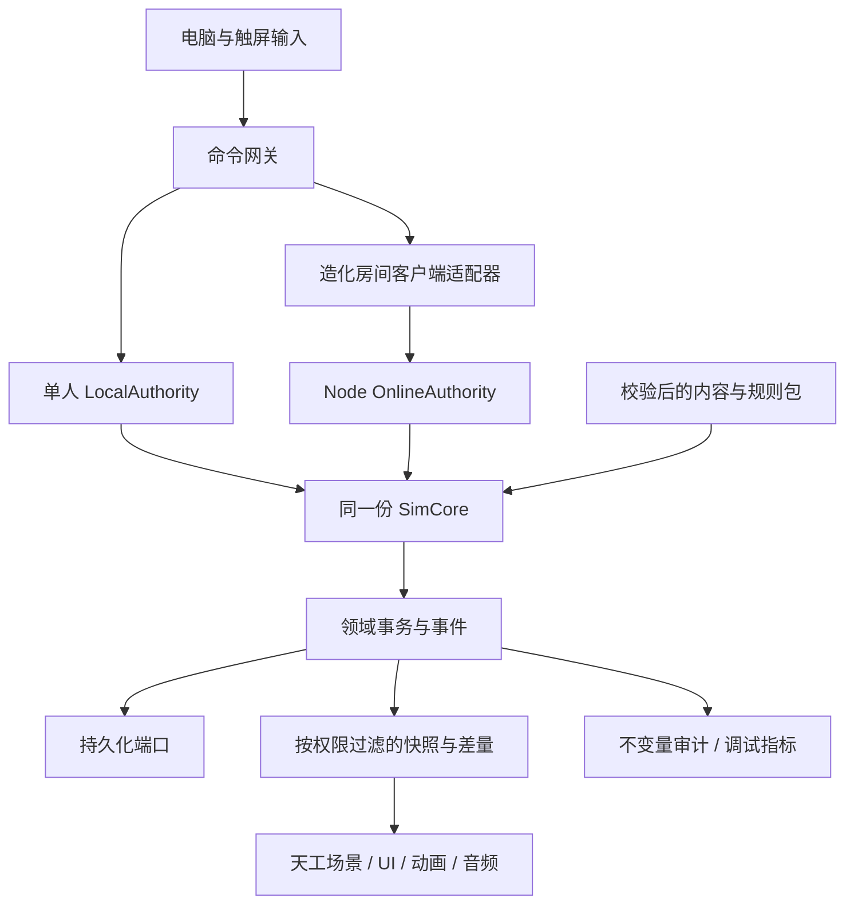

# 余烬边界：底层架构方案 v1.0

日期：2026-11-11  
策划基线：`apocalypse-survival-gdd-v0.4.md`，1280行  
引擎：**天工引擎（用户已确认）**  
文档状态：可进入技术原型的架构提案；未初始化工程、未完成性能或平台持久化验证  
适用范围：单人、最多4人合作、电脑与手机；优先以造化 Web 构建验证，原生商店发行另立验证项

> 本文中的“应当/必须”描述拟建系统的契约，不表示功能已经实现。保持原策划不变；本方案负责将其转为工程设计。项目文件夹名为“末日余晖”，策划暂定游戏名为“余烬边界”，本文沿用后者。

## 阅读导航

- 产品理解、规则和选型：第1—4节。
- 时间、事务、世界、人口、声音和NPC：第5—11节。
- 经济、战斗、随行、研究、联机与存档：第12—18节。
- 表现、数据制作、平台接入、性能、工程和决策：第19—25节。
- 精确数据与接口：配套《数据与协议契约-v1.0》。
- 原型关卡、工作包、92项策划验收追踪：配套《实施与验收计划-v1.0》。
- Claude Code原始意见、采纳与修正：`../reviews/`；未经本方案采纳的意见不是决策。

## 1. 对游戏的理解：架构为什么必须这样分

### 1.1 这是一套持续存在的世界模拟

玩家的主要选择不是“如何击杀屏幕上的敌人”，而是“为了物资、知识和同伴，愿意暴露多少声音、消耗多少资源、承担多少不可逆风险”。经营把短期搜刮转成持续生产，生产又产生噪声并吸引尸群；NPC既是劳动力，也是拥有认知、意愿、成长和组织能力的世界主体；灾害重新分配安全、交通和资源价值；永久死亡赋予这些投资真实代价。[GDD §0、§3、§9、§12、§14]

架构要服务五条因果链：

1. **动作—声学—感知—迁徙—接战—损失**：所有声源都要走同一规则，不能只给玩家枪声写引尸脚本。
2. **需求—计划—材料—运输—工位—产出—维护**：玩家与NPC共用经济和行动执行器，不能离屏免费建城。
3. **天气—水文/结构—地形版本—路径—任务调整—迁移重建**：灾害是世界数据变化，特效只是结果。
4. **身份—知识/关系—死亡—遗物—继任**：角色不是可随时销毁重建的显示对象；死亡和物品必须跨区域、读档与重连持续。
5. **探索—研究—三侧战斗—持续补给—敌人演化**：成长改变手段，不能绕过100生命、真实消耗、必听或永久死亡。

### 1.2 核心设计张力

| 张力 | 不能采用的捷径 | 架构应提供的能力 |
| --- | --- | --- |
| 人口增长与设备承载 | 暗中停增、卸载抹除 | 群体表示、个人档案、工作调度和数量审计 |
| 高智能与几千NPC | 只留下巡逻脚本，后台赠资源 | 认知隔离、持久计划、资源预留、离散事件结算 |
| 微小声音与大地图 | 每个脚步扫描全世界；随机漏听 | 分层声学图、空间索引、准确接收集合 |
| 建设投入与地貌重构 | 只改贴图；读档复原 | 地形事务、版本化派生数据、稳定容器身份 |
| 永久死亡与故障公平 | 断线无敌；静默回档复活 | 托管策略、持久提交、水位标记、故障恢复协议 |
| 多宠物与受控感染体 | 无限后台守卫；收进无消耗背包 | 统一部署预算、独立资格和保有量、真实后勤 |
| 4人分散探索 | 只按房主所在区模拟 | 所有玩家及重要任务区域的关注区并集 |

### 1.3 范围边界

完整目标保留33项技能、三侧13条建议分支、双人口日增、长期地貌、多种灾害和完整伙伴系统。首个原型只用小规模内容证明这些系统共用的规则。受控原型必须标记测试预设，不能把4名NPC和少量丧尸报告为正式世界已经达标。

本次交付是架构与实施方案，不创建游戏、不安装依赖、不发布、不生成具体美术资源。引擎已经确定为天工，后续不再重新询问引擎选择。

## 2. 规则分级与全局不变量

标记定义：**H**=用户设定/策划明确硬约束；**D**=策划补充默认；**E**=本文工程提议；**V**=必须验证的假设。D与E都需版本化，不伪装成用户已确认规则。

| ID | 规则 | 级别与来源 | 可执行约束 |
| --- | --- | --- | --- |
| INV-01 | 人类生命上限100 | H，§2/5/22 | 人类最大生命由类型规则提供，不允许属性修饰器写入，也不增加等价隐藏生命池 |
| INV-02 | 白板同起点 | H，§5/9 | 玩家、初始NPC、日增NPC调用同一个起步模板；性格/背景不附送数值优势 |
| INV-03 | 丧尸初始10000、每天+10000 | H，§13 | `Z_alive = 10000 + 10000*d - Z_dead = placed + pending`；日切清空pending前不推进正常游戏时间；d是已完整结束的游戏日数 |
| INV-04 | NPC初始99、每天+100 | H，§9 | `N_alive = 99 + 100*d - N_dead = placed + pending`；同样受日切屏障约束，不含玩家和感染体 |
| INV-05 | 声学有效范围内必听 | H，§12 | `receivedSet == acousticReachableSet`，反应选择可不同，接收不可随机丢弃 |
| INV-06 | 据点内部不得凭空刷新 | H玩家，D扩展NPC，§8/13 | 新生、扩散、重载与表示转换统一检查；已有敌人的真实入侵必须有路径与时间证据 |
| INV-07 | 永久死亡 | H，§14/23 | `Alive -> Dead`单向；ID不复用；改造、维修、重连、模块切换均不可复活 |
| INV-08 | NPC全部装备可拾取 | H，§14 | 死亡事务把原物品所有权转入遗物容器，不能重新抽取掉落表 |
| INV-09 | 真实有限资源 | H，§8/10/22 | 转移、生产、弹药、能源、载荷统一由权威账本写入；库存不可为负 |
| INV-10 | 从零建造 | H，§8/9 | 初始有效据点=0；世界废墟不自动具有组织归属与运营能力 |
| INV-11 | 最多4人在线 | H，§15 | 平台房间与游戏准入双重检查，房主及观战连接计入容量是本文默认D/E |
| INV-12 | 地貌持久且一致 | H，§4/15 | 地形、碰撞、寻路、伤害、对象位置基于同一已提交版本 |
| INV-13 | 改造不新增人口 | H，§23 | 自由/约束/受控互斥；捕获/改造只转状态，死亡只扣一次 |
| INV-14 | NPC不能全知或免费发展 | H，§9 | 规划器只读取自身信念；执行器仍按世界真值验证动作与成本 |
| INV-15 | 身份与物品唯一 | H/E，§8/15 | 每个实例有且仅有一个持有位置；同一生物有且仅有一个有效控制者 |
| INV-16 | 每日结算幂等 | E保障H，§9/13/15 | 唯一键`(worldId, completedDay, populationKind)`，读档和重试不能重复增发 |
| INV-17 | 同一套单人/联机规则 | H/E，§15 | 共享同一SimCore、内容包和测试夹具，差异只在命令来源、传输、存储适配器 |

重要可调默认：一日30分钟、昼夜20/10分钟、30日阶段目标、每局4个永久角色席位、友伤关闭、无人暂停、NPC据点同等禁刷、3随行/6指挥点、控制数量/稳定性阈值。保存时记录`rulesetId + rulesetVersion + contentHash`，开局界面显示规则预设。

**计数口径**：完成30个整日且没有死亡时，丧尸310000、NPC3099；完成100日时分别1010000、10099。这里不是“第30日刚开始”。阶段目标达到30日也不允许跳过该日跨日账本。

## 3. 天工引擎与技术选型

### 3.1 推荐基线

| 层 | 建议实现 | 选择理由与限制 |
| --- | --- | --- |
| 表现与交互 | 天工引擎、TypeScript、固定斜俯视/正交相机 | 用户明确选择；用2D逻辑+低复杂度几何/像素图集形成2.5D，具体渲染API按安装版本文档验证 |
| 权威模拟 | 引擎无关TypeScript SimCore | 浏览器本地与Node服务端共用，不依赖DOM、渲染器、平台SDK或真实时间 |
| 单人执行 | LocalAuthority；优先独立Web Worker | 用户选择单人后不创建房间、不连接服务端；Worker能力、资源路径与宿主策略先验证 |
| 联机执行 | 造化房间服务+Node权威进程 | 遵守插件服务端合同，不实现自己的平台房间目录 |
| 状态同步 | 权威快照/差量，客户端移动预测与表现插值 | 不采用全客户端锁步，不要求浏览器浮点物理完全一致 |
| 数据 | JSON/表格输入→校验→只读ContentBundle | 规则与数值独立；策划内容有稳定ID、版本与引用校验 |
| 本地存储 | IndexedDB事务+分块快照+提交日志 | Web优先；浏览器配额、清理、耐久性有限，需导出和恢复测试 |
| 在线持久化 | ServerPersistencePort | 平台文档未证明长期世界所需的服务端原子存储，必须先做能力验证；不以客户端云存档替代权威数据 |
| 测试与调试 | 无渲染核心测试、固定场景、故障注入、长局基准 | 先证明世界规则，再堆内容 |
| 未来热点 | 小范围WASM计算内核，按实测再决定 | 不预先引入第二套游戏逻辑、Rust/C++构建链或全量重写 |

**不将“百万世界人口”直接等价为百万个ECS实体。** 也不因TypeScript语言选择就声称性能必定足够或不够。最先验证的数据表示、声音覆盖、NPC调度和持久化，才决定承载边界。

### 3.2 天工的职责边界

天工负责场景生命周期、相机、渲染、材质与图集、动画、输入接入、UI承载、音频表现、资产生命周期和可见对象代理。核心使用自有领域ID；天工实体ID只作为临时显示句柄，维护`domainEntityId -> renderHandle`映射。

逻辑碰撞、命中、导航、声学、人口、经济、NPC计划和地貌真值归SimCore。引擎物理可以提供表现性碎片、镜头和非权威粒子；不得让客户端刚体结果决定物品是否丢失或角色是否死亡。若某个计算模块需要使用天工的可独立服务端模块，必须证明其无渲染依赖、生命周期可控且两端可测试，再通过适配器接入。

工程采用“领域服务+数据导向批处理”，不是把每件物品做成节点、也不是把全部系统写成一个超大ECS World。高频移动/碰撞使用紧凑数组；NPC、任务、研究、组织保留可序列化结构；表现可使用天工ECS，但不把它作为存档格式。

### 3.3 版本与工具约束

已于2026-11-11读取天工官方stable bootstrap。[S1] 创建时从同一稳定渠道解析Engine与SDK，要求精确版本一致并锁定；文档不编造当前安装版本。`@forgeax/engine`是游戏运行时，`@forgeax/engine-sdk`是SDK载体，不加入游戏运行时依赖。`forge.json`、稳定资产GUID、安装后生成的AGENTS与skills是实际工程约定的权威来源。

官方bootstrap当前要求Node至少22.13.0、pnpm为12.10.1及以上且低于13。[S1] 本机仅确认造化状态检查通过Node v24.22.1；当前Shell的`node`不可直接解析，`npx`检查失败，未核验符合该约定的pnpm。架构工作不需要安装；正式搭建前修复环境并重新核验，不擅自切换包管理器。

已存在策划与本次文档的目录不是空游戏目标。建议后续在本项目下创建独立`game/`工程目录，SDK安装在游戏目录之外的单独位置；实际目录遵守官方创建流程，并以工具返回`project_root`为准。本次只新增`docs/`，不伪造`forge.json`或平台元数据。

## 4. 总体结构与依赖方向



### 4.1 五层

1. **内容层**：不可变定义、规则预设、世界生成参数；不保存运行时可变状态。
2. **领域层**：纯数据与规则，无网络、文件、DOM、引擎节点和墙钟时间。
3. **应用层**：命令排序、事务协调、调度器、查询投影、快照、回放、权限。
4. **适配层**：天工表现、造化房间/生命周期/存储、Worker、IndexedDB、服务端存储。
5. **工具层**：内容校验、测试场景、基准、存档检查、开发调试面板。

依赖只能向内。NPC规划不能调用UI，配方不能直接扣平台云存档，声音系统不能访问扬声器音量，地图渲染不能创建世界人口。跨领域写操作由应用层事务协调；事件订阅者生成下一批命令或更新只读索引，不在任意回调里递归修改世界。

### 4.2 领域划分与唯一写者

| 领域 | 拥有的数据 | 对外责任 | 明确不拥有 |
| --- | --- | --- | --- |
| Identity/Session | 世界、角色席位、死亡身份、会话映射 | 身份绑定、权限、死亡状态查询 | 物品数量、平台账户系统 |
| Time/Scheduler | tick、日编号、到期工作、时间倍率 | 稳定时序与幂等日结算 | 真实离线时间补算 |
| World/Terrain | 基底、差量、水深、表面、结构版本 | 当前地形与批量变更 | 显示模型和寻路缓存 |
| Navigation | 各移动类型通行图、路径缓存 | 分层路径与可达性 | 通过修改地形解决失败 |
| Acoustics/Perception | 声学图、声音事件、观测 | 确定性接收、局部感知 | 角色任务的隐藏信息 |
| Population | 两套数量账本、尸群、成员区间 | 生成、迁入、转换和死亡核对 | 无来源造兵 |
| Actor/Needs | 人体状态、技能、伤势、需求 | 统一行动能力与状态约束 | 临时渲染对象 |
| Cognition/Planning | 信念、记忆、目标、持久计划 | NPC选择、解释、重规划 | 世界真值查询后门 |
| Economy/Inventory | 物品、槽位、预留、消耗/产出 | 原子转移、数量守恒 | 动画回调驱动产出 |
| Settlement/Work | 建筑、占据、组织、任务、工位 | 施工、归属、验收、继任 | 免费库存或全图圈地 |
| Combat/Ability | 动作、命中、弹匣、消耗效果 | 合法攻击与伤害提议 | 直接复活和非事务扣料 |
| Companion/Control | 培养关系、控制、部署、骑乘 | 唯一控制与统一预算 | 新增感染体人口 |
| Research/Evolution | 个人知识、组织研究、压力与方案 | 有成本成长与能力激活 | 全局免费共享知识 |
| Disaster/Climate | 气候、事件阶段、影响分片 | 产生地形和状态变更提议 | 任意删除资产 |
| Persistence/Replication | 提交序号、快照、差量、同步游标 | 保持已提交世界连续 | 创造业务事实 |

所有领域共享事务协调器，但不共享一个可被任意模块写入的全局对象。权威状态只能是有schema的纯数据与ID引用；NPC挂起计划、工作进度和定时事件必须显式记录，不保存Promise、闭包、生成器、引擎节点或定时器句柄。

## 5. 时间模型、调度与单写者

### 5.1 三种时间

- `simTick`：唯一游戏时间轴；暂停不推进。日增、饥饿、维护、灾害阶段都使用它。
- `monotonicRealTime`：仅用于网络超时、性能测量和界面，不改变人口或生存状态。
- `renderTime`：天工渲染插值时间；不能直接结算攻击、死亡、资源和日增。

原型从20Hz权威tick（每步50ms）、显示60/30fps目标开始试验。该数值是E/V，不是天工性能结论。长动作使用到期时间和累积工时，远距模拟按离散事件处理，不要求每个NPC每tick规划。

时钟速度影响`simTick`推进，不以大dt跳过事件。加速按所有存活玩家同意、安全与未结算事件条件执行；上限由基准决定。卡顿时限制单帧追赶步数并显示模拟降速，不能丢弃每日新增或直接跳过伤害。

### 5.2 每个tick的逻辑顺序

1. 接收已经鉴权的命令，按`receivedTick + sessionSequence + commandId`稳定排序，限流与去重。
2. 处理日边界及到期任务；日边界提交未完成时不进入下一日的正常交互。
3. 提交到期地形/结构变化，设置局部通行屏障，失效旧导航与声学缓存。
4. 应用玩家意图与NPC执行意图，检查路径、工位、物品和部署预算。
5. 运动/碰撞、能力动作与当前tick声源；传播声音并写入接收记忆。
6. 结算命中、伤势、需求、死亡及遗物；新声音至少影响下一次AI动作选择，不能同tick无限递归。
7. 执行到期NPC认知与计划工作、生产/研究/维护工作，产生后续命令。
8. 核对本次写集不变量，提交事务；生成过滤后的快照差量、调试指标与表现事件。

顺序通过测试固定并写入模拟版本。连续工时、维护缺口和声音持续源保留起止tick；掉帧不会使机器停电免责或产生免费产量。

### 5.3 事件调度

使用按`dueTick`排序的队列/时间轮；长期工作记录`lastSettledTick`、到期事件和累计消耗。危险感知、饥渴阈值、路径断裂、领袖死亡等可提前唤醒NPC。常规工作按预算轮转，不能饿死低优先级队列：记录最大等待时间、饥饿指标与过期任务数。

一局只有一个权威写者。Worker和Node线程并行任务只能读取不可变快照，返回带输入版本的计算结果；主写者校验版本后接受。异步任务过期则丢弃结果并重算，不直接改共享状态。M0先单线程确定正确性，测出热点后才并行化。

## 6. 命令、事务、事件与持久提交

### 6.1 统一处理管线

`Command -> 鉴权/版本/前置校验 -> 事务写集与领域事件 -> 不变量检查 -> 持久提交 -> 发布确认与投影`。

事务规划与候选应用是同步纯函数，禁止await、I/O、Date.now()和未注入的随机源；应用层串行等待持久提交，不能让异步回调穿插修改同一世界。事务是一个进程内的原子业务提交，不引入分布式两阶段提交。两名玩家交接宠物时，先用业务状态保存邀请与接受，再在一个事务中改控制者、预算和岗位。任何半途取消都不产生“双控制者窗口”。

命令包含`commandId`、`actorId`、`sessionId`、`sequence`、`expectedVersion`与负载；身份以服务端会话绑定为准，不信任客户端填写的actorId。事件包含`eventId`、`worldId`、`commitSeq`、`tick`、`causationId`、`schemaVersion`和版本化负载。

### 6.2 两类结果，避免把每一帧都写盘

- **连续可恢复状态**：位置、朝向等权威连续状态保存在周期快照及提交批的连续状态差量中；临时动画不入权威存档，预测状态未提交时可被校正。
- **关键业务提交**：死亡、物品转移/消耗/产出、日增、建造完成、控制权、研究成果、地形长期变化、灾害阶段。必须写入可恢复的事务日志，并在持久化成功后才对外宣称最终完成。

原型明确采用K=0推测窗口：一批持久提交未确认时，权威模拟不在其候选状态上推进后续tick；客户端仅继续允许的本地表现预测。按tick或微批次提交关键事件，而非每发子弹单独等待一次网络存储；射击消耗与命中属于同一已提交因果批。存储往返因此计入tick预算与用户可见确认延迟，必须实测；不先实现多tick推测与撤销日志。若持久化延迟超过预算，进入`PersistenceDegraded`，停止会产生新不可逆后果的权威推进并提示。不能一边报“存档失败”一边继续确认大量永久死亡。

预测命中和死亡动画不能先发放战利品或扣永久席位。致死判定后可进入不可操作的`DeathPendingCommit`过渡状态，提交后变`Dead`；这是存储协议状态，不是可被治疗的倒地系统。提交失败时暂停恢复，而非让角色重获操作继续刷取收益。

### 6.3 幂等与写集

每个事务用命令ID查历史结果。重发同ID与同负载返回同结果；同ID不同负载拒绝并记录。版本冲突明确返回原因，不替客户端猜测物品槽位。写集包含物品位置、数量、人口变化、死亡登记和相关预留；必须整体成功或整体失败。

建立唯一约束：死亡`entityId`、日增`world/day/kind`、奖励`taskId/settlementVersion`、转体`cohortId/transitionId/memberRange`、灾害分片`disasterId/phase/chunk/batch`。网络“至多收到一次”不可假设，用重试+去重得到业务上的只应用一次。

持久存储失败时，尚未提交的候选写集不覆盖上个已提交世界。状态确认必须携带`committedSeq`；快照保留`checkpointSeq`，恢复从其后完整事务重放。提交日志采用完整权威redo patch作为恢复事实，领域事件用于审计与表现，恢复不再调用事件业务处理器。每批patch包含自上个提交边界以来所有需要恢复的变化（包括连续移动、tick、随机流和到期队列），不能只记伤害/物品而把位置留在旧快照。这样恢复到同一提交边界时位置与事件一致。派生缓存可重建，核心身份、物品与死亡不可从视图猜回。

### 6.4 独占写者与恢复中的围栏

浏览器同一世界只能由一个标签页/Worker持有有效写租约；联机同一世界只能由一个权威epoch提交。租约需要存储端的原子获取/条件写与fencing（拒绝旧epoch），不能只靠进程内布尔值或一份心跳文本。第二标签页默认只读或拒绝；失去租约立即停止提交。平台没有这些能力时，该持久世界方案的Gate不通过。

已提交事务损坏与未提交尾部必须区分：只可忽略没有提交标记的完整业务批，不能截断一条已提交死亡或只保留物品事务的一半。详细端口与错误协议见配套数据契约第4节。

## 7. 稳定身份、数据表示与空间层级

### 7.1 身份与状态

所有实体采用`worldId + entityId`，ID由权威分配，永不复用。可使用64位计数，在JSON中用十进制字符串/高低位表达，不能让JavaScript浮点数截断超过安全整数范围的ID。展示名、外观、容器位置、模型GUID都不是身份。

运行时句柄可以复用，但必须有generation，不能作为存档外键。死亡保留最小墓碑和关系引用；显示尸体可以降级，未领取遗物及装备清单保留。

人类NPC始终保留个人身份、性格、目标、知识、计划和关键记忆。感染体可用带成员区间与稀疏例外的cohort紧凑表达；被观察、伤害、捕获、命名、控制或携带特殊资产后必须能恢复同一稳定成员身份，不能重新抽取属性。只有短暂被看到、且没有独有状态的成员可重新压缩进ID区间，不必永远保留一个完整JS对象；命名、记忆引用、伤势、演化或资产差异保留为稀疏例外。

### 7.2 空间尺度

建议从`32×32`逻辑地块/chunk、`8×8 chunks/region`做基准，同时比较64格chunk。这些是E/V。逻辑位置采用地块坐标加定点子格，地貌标高独立记录；渲染投影、相机旋转不改变位置和寻路规则。

地图分三层：宏观地貌/流域/道路图；chunk基础地形；运行时地形差量与实例。基础地图由`seed + generatorVersion`可复现生成，差量覆盖基础值。只持久化种子不够：必须保留生成器版本、必要生成结果和本局变更，不能让引擎升级重画玩家世界。

地块基础通行、水深、表面、污染等用紧凑数组，不使用百万级JS字典。组织、NPC档案和任务分区索引，关系以稀疏边保存，禁止所有NPC两两建立空关系表。

### 7.3 世界容量与无限增长

有限可站立面积与无限日增之间存在真实设计矛盾，不能靠压缩数据宣称解决。[GDD §4.2、§13.1、§20.9；Claude第一轮]

推荐标准世界采用有限阶段目标，并在世界生成时验证至少到目标日的空间、迁入通路和密度压力。为日增分配全局身份/数量，再分批安置；尚未合法安置的数量明确记在`pendingIngress`，不能丢弃。它计入人口守恒的“待进入”子账，但**不冒充已经在可玩地图里的实体**。

待进入队列是E，本方案默认只作短期日切工作队列：标准模式在日边界屏障内完成安置，清空前不继续正常游戏时间。分批计算可以跨现实帧，但不能让累计数日的“在途人口”不感知、不消耗却被报告为完整世界模拟。安置无合法空间时进入可诊断的`WorldCapacityBlocked`，保留账本和待完成批次，不静默吞数、删旧NPC或向基地塞怪。若要允许长期地图外迁入，需另外设计有容量、时间、需求与可感知边界的外部区域并取得规则确认，不能仅用一个无限整数缓冲。对无尽模式，须单独选择：允许按既定地貌规则拓展世界边界，或明确可达容量并结束/迁移世界。两者均为待决内容；首版不承诺有限地图上的无限增长永远可运行。

死亡、群体转换和新生安置分开计账：`alive = placed + pendingIngress`；正式测试同时报告两者，不能只看公式相等。

## 8. 随机世界、地形、灾害与导航

### 8.1 生成管线

`世界预设/种子 -> 宏观标高与地貌 -> 水系/海岸 -> 气候基线 -> 道路/废墟/资源锚点 -> 可达性与生存链验证 -> 初始角色/NPC/丧尸 -> 空占据表`。

每个阶段使用独立随机流，新增装饰不能改变NPC性格、稀有资源或战斗结果。对必需物资使用可达性约束与修复生成，记录修复原因；不是无条件赠送安全营地。初始敌人可处于合法位置，不能与角色碰撞体重叠。[GDD §4.2]

### 8.2 地形真值

每格或稀疏地形片段至少表达：基底标高、长期标高差、材质、水体连接、水面/水深、湿滑/泥泞、雪/冰、盐度/污染、承载条件、结构阻挡。临时、条件持续和永久变更分别保存，天气清除只结束对应效果，不清空永久差量。

地形修订使用`terrainRevision`；导航按移动能力有`navRevision`；声学边有`acousticRevision`。这些可派生版本必须能回溯到同一已提交地形/结构变更。客户端收到新水面但旧导航时不能继续放行；以权威碰撞和短期保守阻挡为准。

### 8.3 灾害状态机

`Eligible -> Forecast/Signs -> Developing -> Impacting -> Secondary -> Stabilizing -> Recovery -> Closed`。

每个灾害保存ID、源与方向、影响范围、强度、阶段起止tick、随机流状态、已结算分片、长期变更与物资位移记录。内陆海啸候选不通过资格检查；气候、天气、灾害是三个互相关联但独立的系统，正常天气具有真实权重。[GDD §4.4—4.8]

大灾害按受影响chunk分片推进，并保存明确的波前/时序；每个分片是原子事务。不能逐格写一半后让玩家进入不一致区，也不需要整张世界一次阻塞数秒。跨chunk连通性更新记录dirty边界，未完成重算的区域临时标记“未知/不可承诺路线”。

### 8.4 陆桥变岛屿的事务示例

1. 决定带来源的侵蚀/沉降提议，检查当前地形版本；临时浪涌与永久标高变化分别建事件。
2. 对影响区进入`Changing`屏障；停止提交使用旧地形前提的新移动/建造/部署。
3. 同一分片事务提交标高差、水状态、道路损伤和对象位置状态变化，不清空所有权。
4. 重建受影响导航门户、陆地连通分量和航行图；大范围拆分使用局部BFS/分层重连，不能只用不支持删除边的并查集。
5. NPC路径与任务依赖标记过期；准备过渡运输或撤离计划。角色按涉水、游泳、漂流、受困/溺水规则处理，不默认瞬移到最近高地。
6. 容器保持ID和完整清单，位置可变成漂流/掩埋/浸没；同一位移批只应用一次。
7. 向客户端发送新版本与分片结果。新版本可用后解除屏障，客户端再允许依赖该区域的操作。
8. 退潮只撤回临时水面；标高降低仍低于正常水面时，岛屿和新海岸保留。

具体涉水阈值、溺亡速度、丧尸水中行为尚需策划表定义；原型可使用明确标注的阈值，不把它们隐藏进渲染代码。

### 8.5 分层路径与运输

区域通路图解决长距离与交通换乘；chunk门户图解决跨块路径；局部网格A*解决个体近距离移动；群体在共享目标下复用局部流向场。路径携带所经过chunk及移动能力版本，过期路径先暂停/校验后重规划。

移动能力分步行、浅涉水、游泳、坐骑、轮式车、船、两栖等；同一地形对不同能力结果不同。任务不能仅保存目标坐标，还需保存可达条件、运输方式、资源和撤退方案。物品运输依靠实体/车辆的真实容量、路线与时间，不能在库存UI之间即时传送。

## 9. 双人口、分层模拟与禁刷

### 9.1 两套账本、两个独立维度

NPC与丧尸分别维护`initialCreated / dailyCreated / dead / alive / pendingIngress`。感染体生物状态`Free / Restrained / Controlled`与表示层`Detailed / Simplified / Cohort`是正交维度，不能把“受控”误当新物种另计数。感染动物是否计入10000池必须在`populationClass`中显式定义；建议纳入感染人口池，普通/非感染变异动植物另账，避免双算，列为D待确认。

未死亡感染体总量满足：

`Z_alive = Z_free + Z_restrained + Z_controlled = detailed + simplified + cohort + pendingIngress`。

第二个等式的各集合必须互斥；每个cohort有唯一owner、人口来源批次、区域、成员区间、类型分布、伤势/能力例外和迁徙状态。

### 9.2 分层原则

| 层 | 对象 | 计算方式 | 不能丢失的内容 |
| --- | --- | --- | --- |
| L0交互 | 玩家附近、战斗、捕获、关键生产区 | 完整个体、精确局部碰撞/感知/动作 | 位置、伤势、物品、动作、真实消耗 |
| L1邻近 | 即将进入交互的路线、伙伴、周边尸群 | 简化运动、共享寻路，提前预热 | 真实抵达时间、个体差异、接收声音 |
| L2远距 | 远区感染体群体；人类仍保留个人档案 | 离散事件、区域迁徙/工作，按需细化 | 账本、目标、计划、库存、记忆、灾害影响 |

L0/L1/L2表示“细节等级”，不表示存在与否。人类NPC不合并成只有数量的统计人口。已命名/受伤/捕获的感染体保存成员例外；受控体、宠物永远保留独立档案。

关注区由四名玩家、有效侦察视野、在途高速载具、关键伙伴、交战/建设/声音/灾害区域共同决定，并设置升级提前量与降级滞后。不能玩家刚转头，追兵就退回无位置统计。远处势力间战斗使用可审计的交互模拟：实例化必要参与者或使用明确资源/命中模型，记录位置、时间、消耗和伤亡；在进入玩家可感知范围前转为L0，不允许不可见对象直接伤害可见角色。

### 9.3 cohort与个体转换

成员位置由共享纯函数`positionOf(memberId, placementPlanId, tick)`确定。PlacementPlan包含固定地形修订下的可站立slot列表、容量、唯一slot分配、分配种子和迁移时序；使用稳定slot序号的双射映射，不能仅hash后取模造成重叠。移除/拆分成员不改变剩余成员slot，变更cohort计数也不重排位置。迁移分配新的有容量计划并保留合法路线与抵达时间。声学、MaterializeExisting和调试展开调用同一位置函数。基础属性用独立稳定成员种子，伤势等为例外。

成员区间保持排序且互不相交；仅在来源、placementPlan和状态完全兼容时合并连续区间，不抹去伤势/演化/物品差异。碎片数、例外数与索引内存做基准，超过阈值转换为稀疏位图/分段表示或压缩索引，保留ID与所有例外，不以删成员降低碎片。阈值由P0定。

升档：锁定cohort修订 -> 选择稳定成员ID与合法位置 -> 检查当前地形/占据/已存在成员 -> 从群体扣除同一成员区间 -> 建立个体状态 -> 同事务提交。降档反向操作；扣除和增加不能分两次独立提交。

转换保留伤势、能力、声源记忆、迁徙路径、抵达时间、人口来源和随机流，不用新随机数重抽强敌。恢复中未提交转换回滚到原表示，已提交转换只重放一次。

已实际沿合法路径侵入据点的群体可以在内部细化，但必须提供可验证的成员来源与穿越记录；没有此证据时，禁止以“转实体”为由在内部出现。生成拒绝不能删除人口。

### 9.4 日增事务

在跨过一个完整游戏日边界时生成一次`PopulationDayCommitted`：同时预留10000感染体成员ID和100个新NPC身份，记录模板版本、性格种子及待安置批次；更新日结算键。NPC的完整人格/计划初始化可在确定性任务中分批物化，但身份、模板和随机种子已固定。

日增是记账，合法落位是后续有状态工作。日切前预检查可用空间；进入日切屏障后提交日键与新增身份，再按现实帧分批落位，标准模式清空队列前不推进正常游戏时间。若无容量且尚未提交日增，则不增加completedDays；若已提交则保留pending并继续屏障。恢复先识别日结算是否已提交，再继续未完成落位，不能重复增发。对`pendingIngress`的安置延迟与阻塞公开诊断，不能无限积欠后宣称完整增长已实现。

### 9.5 统一位置策略

不使用一个含义模糊的`spawn()`包办所有情况。采用`PlacementService`并区分：

- `NewPopulation`：新的日增/初始成员，检查合法地形、碰撞、占据与来源额度。
- `MaterializeExisting`：已有成员升档，检查来源与真实抵达证据，不增总数。
- `MigrateExisting`：区域迁移，保留路径和时间，不当作新生。
- `RestoreExisting`：恢复既有位置；非法位置进入受困/漂移等规则，不重新抽点。
- `ConstructOrDeploy`：有真实材料/生物来源的建造、培养或部署，不和随机刷怪混淆。

植物扩散产生新敌对实体也走新生位置约束；已存在植株有来源的演化是原实体变化。占据判定保存管理锚点、连通建设空间、已清理条件、权限和修订；蓝图/空旗不能形成保护，临时无人不能解除保护。

## 10. 声音与感知

### 10.1 声音是模拟事件

`SoundEvent`记录来源ID、发生tick、当时位置、声学类型、强度/传播预算、持续时间、频带/传播标签和地形声学版本。音频播放器只是消费事件的表现端；静音不改变模拟，系统不读真实麦克风。[GDD §12]

声学采用房间/门户/室外块组成的分层图，边权表达距离、材质、门窗状态、风雨和传播损耗。有效范围由传播预算耗尽的位置决定，不使用“圆内随机百分比听到”。先筛选候选区域，再做有上限的Dijkstra/洪泛传播，最后将结果应用到接收者索引。

### 10.2 必听跨层级成立的办法

必须先固定一份参考声学判定，再优化。每个远距cohort保存可查询的空间占据细胞与稳定成员分配规则，不能只记录一个任意中心点后把全群判为听见或未听见。

传播边界完全覆盖某个同质细胞时可批量写入听觉记忆；部分覆盖时拆分细胞/成员子集并精化，必要时提前升档。任何被不同传播区域、门墙、伤势或迁移阶段区分的群体不能强行合并。测试中把同样成员完全展开，与优化结果逐个比较接收集合，要求零漏报、零多报。

远处NPC施工、机器、动物和灾害同样产生声音。持续声源维护`activeEmitter`及区间，不按渲染帧重复投递；地形改变触发重算。相同时间窗、位置、传播标签的事件只有在数学上保证接收集合与时序语义一致时才可压缩；不得拿“预算不足”作为漏听理由。

接收与决策分开：`Heard`更新记忆，之后按强度、距离、连续性及近身目标选择警觉、转向、搜索或继续攻击。新声源不能自动揭示发声者的后续位置；丧尸记的是发声时坐标。智慧型仍必收事件，只能用已有经验调整行动。

### 10.3 性能与公平边界

最小声音也测试；不把小声音筛掉。传播计算、接收应用与下一次反应的最大延迟有明确预算。若负载导致接收工作未处理完，应限制权威时间推进或增加细胞拆分预算，不能用抽样丧尸回应。日志记录`expectedReceivers / deliveredReceivers / oldestPendingTick`，用于证明规则而非只看画面效果。

## 11. 高智能NPC、记忆、组织与领导任务

### 11.1 三层认知架构

- **信念层**：实体观察、地图知识、资源印象、危险/声源、他人报告。每条记录有来源、时间、置信度、可过期条件。
- **目标/计划层**：效用评分选择生存、休息、资源、学习、关系、建设、研究等目标；HTN分解具有前置与成本的步骤。
- **执行层**：有限状态/动作执行器将计划转为与玩家同类型的移动、交互、搬运、制造、攻击命令，接收失败原因并重规划。

原型不同时实现全套GOAP+HTN+行为树三套大型框架。推荐效用目标选择+小型HTN+可复用动作状态机，够用后再扩展。实时LLM不进入权威决策、生产或战斗循环；若将来生成对话，只能消费脱敏已知信息并输出文本，不能直接改资源或计划事实。

### 11.2 真值与认知隔离

规划器签名只接受`BeliefSnapshot + SelfState + AvailableActions`，不传整个World。NPC可以记错、信息过期、听信可信报告；行动执行时由权威世界检查真实路径、库存与权限，并返回`TargetGone / RouteChanged / NoMaterial / PermissionDenied`等失败。

NPC不能通过未探索容器读取精确库存；工位/组织公共库存可按权限知道。玩家与NPC组织交换情报会产生有来源的知识事件，不把全地图状态广播给所有阵营。

### 11.3 持久计划与协作

计划保存目标、步骤、下一步、依赖、输入版本、已完成事实、失败历史、预留、重规划时间和退出条件。离屏保留这些内容，只减少唤醒与运动细节。相同失败有退避、备选和风险记忆，防止每秒撞同一扇门。

共享资源必须预留：物资、工位、床位、施工位、运输容量和奖励。预留有持有者、任务、有效期、续约、取消和拥有者死亡处理；实际消耗仍需事务提交。不是提前扣完全部材料，也不是两个NPC同时把一份库存写进计划就算拥有。

### 11.4 工作与组织

角色最多一个直接上级；组织关系加入前做环检测。组织、控制、财产、友好、知识权限各自建模，不把“加入组织”直接等同于控制角色。NPC可拒绝超风险任务，招募玩家必须收到玩家主动同意。

任务状态：`Draft -> BudgetChecked -> Published -> Accepted -> Executing -> AwaitingInspection -> Settled`，另有`Paused / ReplanRequired / Cancelled / Failed`。验收依据物资实际入库、指定建筑达到版本、真实救援到达，而不是某次采集事件曾发生。奖励从发布者库存预留，幂等结算。

领袖死亡时：冻结其个人控制权限；组织公共资产不随之消失；任务按组织继任规则移交或释放预留；个人奖励来源不足则明确标记，不能凭空补奖。组织继任与玩家操作权分离，幸存NPC不会自动占有玩家席位。

### 11.5 智能验收

至少建立断粮补给、工地缺料、工位争抢、门桥被毁、同伴受伤、有限弹药撤退、可信灾害撤离、知识不足先学习、领袖死亡继任九组固定场景。记录目标选择原因、计划、执行事件、消耗和失败修正。

成功指标是达成目标/合理放弃、耗时、资源合法、认知合法、重复失败次数、规划p95/p99与最长等待。不能以对话流畅、站桩不死或关闭规划后的FPS作为高智能证据。

## 12. 物品、生产、建造与经营

### 12.1 物品守恒

唯一装备/容器具有实例ID；可堆叠资源具有stackId、类型、批次、数量和品质/保质状态。每个实例或堆叠只有一个位置：角色装备槽、背包槽、工作台投入区、车辆弹药箱、世界地面或遗物容器。

拆分新建stackId但继承来源，合并只允许兼容批次与状态，数量守恒。每次转移校验所有权/权限、距离、容量、重量、版本和预留，不允许客户端提交“目标数量”。账本按物品类型核算`期初 + 合法来源 - 合法消耗 = 当前存量`；配方转化要同时记录不同输入、输出及损耗，不能错误地要求全游戏所有物品数量总和不变。

### 12.2 长流程作业

制作/施工/研究/感染体改造均使用持久Job，但各自保留业务状态机。Job记录定义版本、工位、操作者、材料预留、已投入、已消耗、未用、已做工时、能源、噪声、产出提交ID和中断原因。

断电、缺工人、撤离、洪水时暂停；消耗按工艺阶段发生，不允许取消退回已消耗资源。完成事务消耗剩余合法投入并产生唯一输出，之后重试返回完成结果。工位被毁时未用物资、半成品与已耗材料分别处理，不能默默吞掉一箱投入。

### 12.3 建造与占据

蓝图保存占地、功能、前置、材料、工时、施工噪声和阻路预览；蓝图不自动生效为实体墙。每个建筑始终保留同一实例身份，升级记录版本和已投入，不销毁旧建筑再复制库存。

占据服务根据有效锚点、实际建设/改建、连续清理空间与管理范围求边界；已有敌人不能因圈地消失。结构破坏、地形变化、锚点失效都触发明确重评估，不能把“渲染没加载”作为弃营。基础设施功能来自实际状态与资源，断电工坊不能继续报告满额产能。

### 12.4 生产网络

电力、供水、道路运输分别是有容量、损耗和可失效边的网络。先做可解释的离散分配与优先级，不先上全物理电网/流体。公共库存只提供库存视图，资源实际位置不合并；领袖能安排跨仓搬运，但UI不能免费汇总后立即用于远方工地。

食品状态按上次结算时间、温度和保存条件更新，存读档不中断腐坏。作物、畜群、设施、设备和驻留伙伴持续维护，远距结算不等于免消费。

## 13. 战斗、死亡、遗物与载具

### 13.1 统一能力执行

武器、陷阱、动物动作、受控感染体、义体和生化能力共用`AbilityDefinition + ActionInstance`。定义包括目标类型、前摇、有效窗口、恢复、消耗、噪声、射程/形状、命中规则、冷却、友伤策略和附加状态；伤害由权威处理。

客户端预测移动、抬手、瞄准和射击反馈，不能预测永久战利品或最终死亡。开火请求由权威检查动作阶段、弹药/能源、射界、距离、当前地形与权限。消耗、发射体创建、命中与伤害有因果ID；重发命令、上下坐骑和换座不能创建第二次命中。

弹药来源统一为真实库存。原型建议：更换弹匣在装填完成时原子交换，逐发武器每一发装入时原子转移；不同模式显式配置。中断保留已完成转移，不整批重置。近战耗体力，能量武器耗储能，生化能力耗真实载荷/代谢；冷却结束不补资源。

原型不做激进回溯命中。使用有限长度的权威命中历史时，必须保存该时刻的地形/门墙版本，禁止回溯射穿已经关闭的门而没有明确公平规则。网络延迟上限与辅助瞄准属于测试项，不因触屏改变伤害或听觉规则。

### 13.2 死亡事务

一次死亡事务至少包含：

1. 校验该实体尚未死亡，生命/结构达到死亡条件。
2. 写永久死亡墓碑、原因、tick、伤害来源与最后提交状态。
3. 生物人口扣一次；感染体从当前自由/约束/受控状态退出，人类NPC从NPC账退出，玩家不扣NPC总数。
4. 原装备与背包位置整体转移到稳定遗物容器，记录完整清单，不抽掉落比例。
5. 取消动作与操作权，释放/转移工位、物品预留、组织职务和任务。
6. 伙伴执行应急策略；玩家席位转为`DeadSpectator`，令牌仍绑定原死亡身份。
7. 持久提交后广播结果。没有存储确认，不宣称不可逆后果已保存。

角色生命0即死亡是玩法规则；不存在死亡后急救。服务端的提交中状态只是禁止继续操作并等待存储确认，不是玩法上的复活窗口。

### 13.3 遗物与世界变化

遗物容器和死亡实体分别保存：外观尸体可用简化渲染或隐藏，未领取物品不可因chunk卸载、尸体腐烂、灾害或清理缓存删除。漂流/掩埋记录真实位置状态，取回可能需要搜救/挖掘。物品耗尽后可压缩空容器，但保留必要死亡与事务引用。

丧尸普通尸体外观的生命周期可配置，特殊/已控制个体死亡记录保留；腐烂不能凭空清除其实际携带物品。进一步火焚装备等销毁机制需重新确认与GDD“全部可拾取”的边界，本方案不暗加。

### 13.4 载具与骑乘

机械载具包含底盘、安装位、座位、部件、燃料/电池、热量、承载、浮力/涉水能力、库存和操作角色。司机/炮手通过座位租约绑定到实体；换座需要原子释放/占用，不能双人占同座。模块拆卸返还当前存在且当前耐久的部件，不返全新零件。

动物骑乘复用`Attachment/Seat`关系与输入路由，但不复用机械载具的生命和修理规则。骑手与坐骑各自有生命、伤势、动作和消耗；命中目标明确。下马后仍保留动作恢复tick，不能取消前摇后摇刷伤害。

高速载具扩大预加载与导航关注区，不等到进入未加载chunk才生成碰撞。速度上限受实际地形、水深、载重与可预热范围约束；不能为掩盖加载延迟随意传送。

## 14. 宠物、受控感染体与统一部署

### 14.1 四个不同概念

- **培养/保有关系**：一名角色可以长期照料或保有多少对象。
- **当前控制权**：每个对象同一时刻唯一有效控制者。
- **部署岗位与范围**：随行、驻守、运输、隔离、休息、应急等真实状态。
- **共享指挥预算**：当前主动行为需要多少指挥资源，骑乘计一次。

不能用一个`ownerId`代替全部概念。财产所有者、照料者、有效控制者和任务发布者可以不同，但权限有明确规则。

### 14.2 预算策略

采用GDD的待平衡默认：每人最多3个主动随行，指挥点上限6；可用预算为`max(驯兽解锁点, 生化研究解锁点)`，不相加。小/中/大宠物1/2/3点，普通/精英/特殊感染体2/4/6点。[GDD §10.8、§23.2]

预算之外同时检查：宠物训练和培养上限；驾驶、鞍具、健康；感染体研究、保有量和种类限制；设施、控制距离、稳定性和维护。驯兽不能借生化预算直接获得驯服资格，反之同理。

驻守或远方任务有`ControlPost`：有限位置、所属控制者、范围、能耗、任务负荷和供给。原型默认所有主动战斗部署仍消耗该控制者可用预算；若后续设计独立据点控制网络，必须给出独立有限容量与测试，不用“备用/休息”标签免单。休息允许自保，不能持续执行远程集火。

变化时重新校验：部署、交接、上/下骑、体型变化、能力激活、控制设备损坏、读档、断线与控制者死亡。超预算进入可解释的受限/撤回状态，禁发新主动战斗指令；不删除动物、不瞬间杀死、不保留无限免费指挥。

### 14.3 改造流程

`ExistingAlive -> Captured -> Transported -> Isolated -> Assessed -> PlanChosen -> Modifying -> StabilityTest -> Controlled`。失控可回到自由状态但仍是同一ID；重新控制不重置伤势、资源和能力。死亡为终态，样本研究不能恢复原体。

改造方案先预览，再固定版本、保留特征、比例、成本与种子。保留比例作用于“进化增益”，例如原增益40%，保留70%得到额外28%，不是把基础速度乘到28%。能力范围、冷却、次数、能耗分别配置，不只缩小伤害面板。[GDD §23.4]

改造中的每阶段投入、消耗、伤势与未用物资独立保存；取消或失败按阶段释放，不能全退已耗核心。控制稳定性变差时按已声明阈值警告、降载、限制新任务、回收/隔离、应急；断电不瞬间变满血敌人。

控制范围断裂、道路被海水切断时选择真实可行的停机/等待/返回。单人和联机都在权威端执行。观战者没有控制权限，幸存者接管必须满足资格、距离与余量。

## 15. 技能、研究、三侧成长与演化

### 15.1 数据模型

33项技能是共享定义，不为玩家和NPC分别写表。`SkillProgress`记录经验、等级、知识前提和实践来源；`KnowledgeRecord`记录阅读/教学获得的知识，和物理书籍实例分开。重复阅读用角色×知识单元去重主要收益，不能换一本同内容书无限刷满。

研究成果按个人/组织明确持有，不全世界免费共享。书籍、样本、教学、交易、合作分别有事件来源。知识可以传播，物理书籍不能复制；若设计抄写，必须有独立材料工时配方。

### 15.2 三侧13条分支

| 路线 | 分支 | 成长对象 | 共同底层设施 |
| --- | --- | --- | --- |
| 科技4支 | 精密火力、重装载具、无人战术、工程防御 | 外部装备和机器 | Job、库存、能源、能力、载具/设施 |
| 生化5支 | 生物军械、战兽共生、生态控场、战地生化、感染体改造 | 生物产品、伙伴、生态设施 | Job、健康、载荷、伙伴、控制与人口 |
| 改造4支 | 机械义体、基因体能、神经战术、环境适应 | 有身份的个体 | 适配槽、技能、状态、能力、维护 |

三侧独立内容不能被统一底层吞掉：不同工位、成本、成长前置、战斗输出和维护定义仍需制作。每侧至少完成一条“白板→资料→设施→投入→战斗产出→补给→维护”的闭环；共同工艺不能要求另一侧高阶研究才解锁第一项战斗能力。[GDD §22]

研究DAG做循环检测和白板可达性分析，分别验证三侧独立起步。高级组合检查适配槽/能耗/代谢/控制预算，不以无上限叠加提供成长。人类最大生命校验在最终属性合成后再次断言。

### 15.3 演化框架

压力记录来自实际区域与个体暴露：声音、气候、水、盐度、污染、食物、战斗存活、阻路、迁移和群体互动。不同物种拥有独立可选分支和门槛；阶段过程有来源、成本、表现和完成事件。

`PressureRecord -> CandidateEvaluation -> Progress -> CommitTrait -> RevalidateCapabilities`。记录当前与历史随机流状态，新增装饰不影响变异抽取。日期只影响环境与机会，不直接在第N日赠送固定能力。

cohort可以保存同质分布，发生不同经历时拆分；遇到个体时用稳定成员记录恢复，不每次加载重抽。局部灾害不让全世界获得同一抗性。受控体可以积累潜在变化，但新增表达需复检、支付成本并重新检查预算；不能临战免费激活超限能力。

## 16. 单人、四人联机与权限

### 16.1 同一权威核，两种运行方式

**单人**：浏览器主线程运行天工；LocalAuthority在Worker中运行SimCore，经批量消息交换命令与只读投影。若宿主不允许Worker，必须先验证主线程低负荷路径，未达标准则明确限制预设/设备；不能连接隐藏云房间冒充离线单人。单人支持真实暂停，暂停时NPC、声音模拟、作业、维护和世界日都停。

**联机**：浏览器仅为客户端，`game/server`运行同一SimCore。造化SDK负责目录、准入与传输；游戏负责人物席位、权限、命令验证、世界状态和长期存档。平台“房主”是房间角色，**不是浏览器充当权威服务器**。[S3]

不设计ENet/WebRTC/P2P双栈作为首版；不在后端故障时切到客户端权威。Server端只打包运行模拟所需模块，不引入天工渲染器/浏览器依赖。官方脚手架建立后再接adapter，不自己手搓平台房间协议。

### 16.2 三层身份

1. 平台用户身份：SDK/房间服务返回，负责真实连接归属。
2. 会话身份：每次有效连接的sessionEpoch与序号，过期连接不能继续提交。
3. 世界角色席位：长期`worldId + seatId -> playerId + characterId + deathState`，重连保存；跨房间重建的恢复以第17.4节平台持久化Gate通过为前提。在此之前，联机只能标为会话级试验，房间销毁后不承诺可恢复。

推荐一局至多4个永久角色席位（D，GDD §14.2）。离房释放的是在线连接位置，不释放已绑定角色身份；同一账号重进取回原角色，死亡仍观战。第五连接包括额外观战者默认拒绝。若将来允许独立观战人数，需单独准入与不可写权限设计。

初次加入只使用未绑定席位和共同白板模板。推荐新身份绑定需世界拥有者批准，界面明确显示新角色。平台账号是身份边界，无法证明两个账号属于同一自然人；4个永久席位能限制总角色数，不能宣称完全杜绝多账号占用空位。中途加入位置必须合法，队伍可以提供实际建成接入点但不能由加入流程免费建营地。所有已绑定玩家死亡时结束本局，不通过尚未使用席位再造新角色绕过结束。

### 16.3 联机协议

握手协商`protocolVersion / buildId / simVersion / rulesetHash / contentHash`；不兼容则明确拒绝。命令只传意图，不能发送客户端库存、生命或最终命中作为事实。

同步按关注区：每客户端附近实体、已获情报、授权公共库存/任务、当前地形差量与必要全局时钟。服务端不发送未知敌人精确位置和他人隐藏背包。4人共享世界不等于共享全部侦察视野，情报共享按规则实现。

加入/重连先取得世界清单、当前死亡与席位、所需chunk完整版本、关键对象快照，再接后续差量。客户端必须确认基线版本才能发出依赖地图的动作。差量带`baseRevision -> newRevision`、序号和校验；基线缺失请求局部完整快照，不能继续“猜应用”。

建议输入20—30次/秒、状态差量10—20次/秒、渲染插值约100—150ms作为测量起点；均是E/V。低频变化不每tick发全量，地形快照分片、背压发送；平台当前二进制帧上限1MiB，只是传输上限，不作为推荐单包大小，实际API与协商以SDK版本为准。[S3]

### 16.4 断线、暂停和后台

将“网络故障本身不额外扣生命”与“已经处于真实危险中的角色继续承担风险”分开。推荐断线后进入防御性托管：停止新高风险任务、沿已知合法路线撤退/自保，不获得无敌、瞬移或自动满血；持续时间是配置与待平衡项。必须在进入游戏前告知。断线期间仍可能被既有威胁杀死，这是需确认的D，而不是宣称能完全消除故障导致的体验损失。

安全离开采用`ExitRequested -> SafetyCheck -> Departing/Sheltered`，该流程只控制游戏内调用`rooms.leave`之前的退出意图，无法阻止关页或平台直接离房；角色或其托管状态继续有可恢复身份。禁止脱战失败时立刻移除身体以逃避危险。主动离开和网络断开分别处理，不允许连接层`removePlayer`直接删除人物。

最后一名在线玩家离开后，按默认暂停世界；正常退出尽量处理当前关键提交后停钟。但平台可能立即销毁空房间进程，不能假定stop回调一定完成刷盘；必须依赖持续增量持久提交，并验证stop宽限。恢复不使用现实离线时长补算饥饿或日增。只剩观战者、仍有断线但活着的玩家时，是否继续推进应按显式世界规则处理；建议停止新的世界推进等待活人重连，避免观战连接让离线幸存者长期饿死。

联机中一人开背包、切后台或收到平台pause，只暂停其本地输入、渲染/音频或进入托管，不暂停其他人的世界。只有全体同意且安全时才世界暂停/加速。区分`presentationPaused / inputSuspended / worldPaused`，平台生命周期状态必须反映真正暂停的对象。

### 16.5 房主、世界拥有者与房间生命周期

`worldOwnerId`、平台host席位和权威进程分别建模。平台离房可能自动转移host，不能因此转移存档所有权或新造角色。GDD“首版房主退出保存结束”是房主持有世界方案的建议；本方案因采用平台权威进程，将其映射为**世界拥有者显式结束会话**，普通离房按持久席位和最后玩家暂停处理。此项是需确认的E差异，不静默把平台自动host转移当作“已支持无缝权威迁移”。

真正的进程故障恢复依靠持久世界+写者epoch，未完成平台持久化验证前，不宣称在线世界可跨服务器销毁恢复。该阶段的在线演示明确为会话级试验。

### 16.6 房间如何装载世界与准入

房间ID不是worldId。长期世界恢复建议先建立已认证的房间连接，再通过游戏自己的`SelectWorld`命令传递待装载worldId及受支持后端签发的不透明授权引用；服务端依据官方身份上下文与WorldAccessPort校验。不能把公开metadata当作授权/存档载体，也不能假定平台create请求支持任意私有data字段。实际授权凭据的签发与校验机制属于P0-09平台能力验证，未找到受支持路径时该Gate不通过。

准备状态由受信任的创建者/拥有者选择或新建世界，权威使用`runPreparation`等官方准备机制装载，申请写者租约，恢复席位与提交水位，完成后才发送game_init并开放操作。装载过程中不以未经授权的第一条客户端消息决定worldOwner。当前roomId到worldId映射及租约由权威保存；离房后恢复必须重新鉴权，旧room token不当作永久世界凭据。

4人上限在官方工程元数据、建房`maxPlayers`及游戏准入同时约束。`onCheckJoin`按官方合同只读取已加载的席位/批准表，不生成角色、不写库存、不做长时间存档加载；实际角色绑定在成功入座回调之后进入串行命令事务，再次检查空位。并发预检不能超发角色。死亡身份允许在容量内以只读观战准入，不能因此再次绑定；新身份须满足未绑定席位与批准条件。平台回调时限与当前配置以安装版本合同验证，超时明确报不可用。

## 17. 存档、恢复、迁移与长期世界

### 17.1 逻辑存档组成

- Manifest：世界ID、创建时间、种子、生成器/模拟/协议/内容版本、规则预设、tick、已结算日、checkpointSeq。
- 个人实体：玩家、全部NPC、宠物、受控/受伤特殊感染体、技能知识、需求、关系、记忆与计划。
- 空间数据：生成参数、chunk差量、结构/道路、占据、容器与物品、移动/漂移状态。
- 人口数据：cohort及成员区间、稀疏例外、安置队列、日增幂等记录、死亡统计。
- 长流程：任务、预留、制作/施工/研究/改造、灾害阶段与分片、演化压力。
- 权限：永久角色席位、组织、有效控制者、部署岗位、世界写者epoch。
- 日志：checkpoint后完整提交、命令去重窗口、永久业务唯一键与死亡墓碑。

渲染对象、天工临时实体句柄、音频播放游标、导航缓存不作为权威存档；可由已提交数据重建。

### 17.2 保存/恢复算法

保存使用固定committedSeq的不可变视图：P0小世界可测量受控暂停复制；标准世界采用chunk/实体页的代际写时复制，快照引用旧页，后续写入复制被改页，限制峰值并设置背压。不能一边修改同一数组一边异步序列化。

保存：在提交边界冻结只读快照 -> 分块写新一代checkpoint -> 写完整清单与校验 -> 原子更新activeManifest -> 保留上一代已校验备份 -> 仅在新代验证通过后压缩旧日志。大存档分片时，不能先把manifest指到一套尚未写齐的chunk。

恢复：选最高完整有效manifest -> 校验版本/内容 -> 读取snapshot -> 顺序应用后续完整事务 -> 忽略未提交尾部 -> 重建索引/导航 -> 校验人口、物品、死亡、控制预算与身份 -> 发布可操作世界。恢复损坏不能悄悄退回死亡之前；若无法证明最新关键提交完整，应进入恢复阻塞并给出诊断，不以“正常读档”包装数据丢失。

完整提交批重放以版本化redo patch恢复，不重新执行随机命令或业务事件。行为再模拟只保证在固定模拟版本、内容和随机流下可验证；不宣称跨引擎/浏览器版本自然逐位一致。回放记录已经决定的随机结果与重要业务结果；任何版本迁移有单独迁移程序和夹具。

### 17.3 本地Web持久化

IndexedDB用事务提交关键写集与提交标记，chunk采用代际快照。检测配额、异常、私密模式和可用容量；申请持久存储只能当作请求，不保证浏览器永不清理。保存成功表示浏览器API已完成相应事务，不等价于所有设备断电下100%落盘保证。[S4]

提供用户可导出的带清单与校验的世界包和恢复检查器；它是备份工具，不在标准流程提供撤销已提交死亡的按钮。本地文件可被用户改动/回滚，这是明确的信任边界；校验和/哈希链用于检错，不能被称为防作弊或绝对永久死亡保证。

### 17.4 平台在线持久化是开工门槛

当前插件文档确认客户端`storage`能力和Node房间模拟，但本次没有证实服务端长期存储的事务、配额、租约、生命周期、房间重启和恢复合同。客户端云存档接口不自动满足多人权威长期世界要求。[S2、S3]

必须完成P0验证：

1. 查清Node权威进程可使用的受支持存储、认证方式和持久性；不能把临时磁盘当永久盘。
2. 验证原子提交或可构造的事务日志协议、条件写/单写者租约、数据上限与吞吐。
3. 模拟房间正常停止、进程被杀、宿主重启/重新分配，能恢复同一worldId及死亡/物品/日增水位；验证stop是否有执行保证与刷盘宽限，正确性不依赖退出回调一定执行。
4. 验证平台身份稳定性及旧会话拒绝。存档写者epoch递增，旧进程不能重新覆盖新状态。
5. 核验房间的世界选择/装载授权、onCheckJoin只读准入时间预算、用户身份跨设备稳定性、客户端Worker/IndexedDB可用性、云存档单键与频率限制。插件断连表与正文分别出现30秒与默认300秒等差异，必须以当前SDK配置/实测确认，不能硬编码。
6. 若平台不支持所需能力，采用经确认的外部权威持久化服务，或把在线版本明确限制为会话试验；不得把“只保存到某个玩家云槽”宣传为完成持久世界。

外部服务是条件分支，不在本次擅自部署Cloudflare/数据库或申请账号。首次实现优先小型模块化单体；一个世界一个写者，跨世界独立存储。不预建微服务、Kubernetes或全局分布式事件总线。

### 17.5 容量与数据生命周期

低价值遥测有保留期；临时粒子/声音播放记录可以清理；已完成可重建缓存删除。死亡身份、未领取NPC装备、关键成员例外和仍被引用的关系不可因TTL清除。长期日志在校验checkpoint后压缩，保留必要唯一键/摘要防重放；不是永远保存每个移动tick。

物品/记忆压缩不改变玩法事实：重复经历可汇总成计数与最近时间，但救援、背叛、承诺、重大危险和死亡等关键记忆保留。稀疏关系可归档到冷存储，不能让久别NPC忘记所有关系。

## 18. 安全、错误处理和可解释性

所有可写命令验证：身份与席位、角色是否存活、所属权限、距离/视线/范围、物品版本、资源/资格、动作阶段、地形版本、速率与负载大小。客户端只能提出意图；观战者白名单只允许切换视角/查询已授权信息。

关键错误必须可分类：`VersionConflict / OutOfRange / MissingMaterial / KnowledgeMissing / RouteInvalidated / CapacityExceeded / ActorDead / PersistenceUnavailable / WorldCapacityBlocked`。UI显示原因与可行下一步，不使用“操作失败”掩盖设计约束。

调试面板能查看某个NPC的已知信息、目标权重、计划、失败与资源预留；某个感染体的人口来源、成员ID、声音接收与转换；某个物品的来源与转移；某片地形的灾害来源和修订。诊断访问权限与玩家视图分开，发布版不能借调试接口全图透视。

## 19. 天工2.5D像素表现与跨端输入

### 19.1 表现策略

逻辑世界保持2D坐标、独立标高与水深。推荐先比较两种天工表现原型：正交相机下的低面数地形+像素图集角色；或等距地块/精灵代理。选型看屋顶遮挡、水面、排序、透明重叠、像素稳定和手机成本，不改变SimCore。

固定斜俯视、地块逻辑位置与投影独立。角色按脚底落点排序，遮挡分层；进入室内时屋顶淡出，不能让遮挡隐藏致命目标而无反馈。水深、塌陷、冰面和长期岸线必须直接读取对应地形修订的投影。

像素美术可以以策划64×32地块、32×48角色为测试尺度，但不是最终强制尺寸；使用图集、就近采样和有限缩放档位后实机检查抖动/摩尔纹。界面文字采用小屏可读字号，不强制像素小字。装饰物、阴影和粒子可降级，禁止按画质档关闭声学/NPC规划或改变敌人数量。

可见对象池仅缓存表现资源，回收渲染代理不删除领域实体。chunk加载有取消、版本检查与资源引用计数，过期异步加载不得覆盖新地形。

### 19.2 输入与UI

抽象`MoveIntent / AimIntent / InteractIntent / BuildPlacement / CompanionOrder`，键鼠、触屏和后续手柄只映射意图。手机横屏为D；摇杆、瞄准、交互目标和建筑确认区域独立，不把桌面UI缩小后交付。

首批UI：生存状态与来源、噪声风险、背包容量/重量、制作材料与中断、建造确认、NPC任务与拒绝原因、天气/撤退方向、伙伴数量/指挥点/维护、保存与网络状态。关键危险动作（开机、开火策略、毁坏结构、高成本改造）给预览与确认；即时战斗不滥用弹窗打断操作。

音效与模拟声音分开。字幕、方向提示和风险图标支持静音；不能显示未发现敌人的精确坐标。手机离开前台、来电、锁屏与返回必须纳入真实设备验证。

## 20. 内容与资产管线

### 20.1 内容表

至少建立：33技能、起步模板、性格维度、需求/状态、物品/堆叠、配方、建筑/升级、工位、组织任务、动作/能力、弹药/载荷、物种/宠物、训练、底盘/模块、研究13分支、演化、天气/灾害、地形材质、移动能力、声音、伙伴预算、控制方案与规则预设。

内容采用稳定英文ID与中文显示文本分离，ID不可复用。`ContentBundle`包含版本、哈希、依赖清单和生成工具版本；保存与联机握手绑定。删除内容需要迁移/替代映射，不能让旧档引用静默归零。

### 20.2 自动校验

检查引用存在、重复ID、非负数量、单位一致、概率权重合法、研究DAG无环、三侧白板可达、配方不存在无成本正循环、动作有资源来源、特效不越过权威范围、宠物资格与预算一致、死亡状态没有恢复路径、人类无maxHP修饰器、灾害地貌资格正确。

配方循环不全部禁止：可逆拆装允许但必须保留实际部件、损耗/成本，不能制造净增。技能0级的最低生存链必须可达，基础水上生存不能要求某侧高阶研究。音效资源缺失不应使模拟声源消失。

### 20.3 资产

天工资产GUID与内容ID建立映射，资产更换不改变生物身份或存档引用。像素图集、动作方向、帧率、碰撞轮廓、脚底锚点、屋顶分层和水位表现先统一规范；占位资源和最终资源使用同样逻辑接口。

造化素材库状态返回地址为`https://zaohua.qq.com/library?engine=forgeax`。可按类型/关键词筛选预览；本地预览入口可下载到`assets/library/`，也可由Agent按具体需求检索接入。当前未登录，且本次只设计资产管线，没有进行素材检索；不能声称库中已有或没有某类合适资产。后续具体素材任务再按插件登录与来源核验流程执行。

## 21. 造化接入与构建合同

### 21.1 创建与初始化

正式搭建时使用插件官方创建流程，复用用户已选“天工引擎”；平台PC/mobile/both尚需按创建流程取得明确选择，GDD设备目标不是代替创建确认。读取工具返回的天工bootstrap，再读取实际SDK和生成项目的AGENTS/skills，遵循版本匹配与目录检查。

使用官方安装器接入`zaohua-platform-sdk`。天工的`initialize()`位于非Pack运行时入口，在引擎异步启动前完成；不能把它放进Pack的apply阶段或自定义HTML入口。初期仅声明已经实现的能力，不写假初始化成功。[S2]

潜在推荐能力为`storage`和`game.multiplayer`，因为本作有长期进度和合作。推荐、实际SDK声明和`multiplayer.enabled`是三个不同事实；仅有文档时不创建元数据宣称已集成。加载、生命周期、日志和用户信息按真实使用逐项接入。FPS由SDK自身报告，不新增FPS能力或手写`fps.start()`。[S2]

### 21.2 联机服务端

官方`enable_multiplayer`产生/接纳服务端骨架后，实现适配器。打包为Node可加载的普通JS入口`game/server/dist/index.js`，需要的runtime依赖按插件约定内联。服务端实际建立可监听房间服务；仅导出`createRoom`等函数不等于已接入。[S3]

平台房间能力只能在用户选择多人之后调用。单人路径独立运行本地核心。Preview与发布使用同一SDK房间路径，不用环境探测切换为自建房间、不直接访问`window.PlatformClient`内部对象。

首版既定4人上限写进平台与领域准入；平台`wired`表示布线达上传门槛、`verified`至少观察到两人入座和开局，均不能替代本项目四人/持久世界验收。[S3]

### 21.3 预览、发布与验证

开发使用造化Preview，修改后reload现有会话。天工普通预览与发布玩家包可能走不同产物路径，发布前必须验证真正玩家包，不手改生成的`dist/`、SDK状态或绕过官方适配。[S1、S2、S3]

验收按：核心测试/类型检查 -> 天工项目检查与构建 -> 插件预览 -> 单人输入/加载/暂停 -> 四人状态 -> 持久化故障恢复 -> 手机实机 -> 发布就绪检查。可访问的previewUrl不是完整验收通过。

本次没有发布授权，不构建上传。后续首次获得game_id时，团队共用发布目标还是个人独立发布需明确，不能把本机绑定无说明地交给团队。

## 22. 性能预算与扩展策略

### 22.1 首轮目标，不是承诺

| 项目 | 原型起始目标/测试维度 | 判定方式 |
| --- | --- | --- |
| PC画面 | 60fps目标，帧预算约16.7ms | 指定设备与画质，p50/p95/p99、长帧比例 |
| 手机画面 | 30fps目标，帧预算约33.3ms | 真机温升/续航和15—30分钟持续运行 |
| 权威模拟 | 20Hz试验；p95计算尽量≤25ms，p99<50ms | 含真实NPC、声音、灾害和审计，分模块记录 |
| 人口扩量 | d=0/7/30/100及继续增长 | 不计死亡对照为1万/8万/31万/101万感染体 |
| NPC扩量 | 99/799/3099/10099个持久个人 | 目标质量、任务延迟、认知与资源合法 |
| 可见感染体 | 100/300/600阶梯负载 | 这是测量档位，不是产品同屏承诺 |
| 玩家/伙伴 | 4人分区，D默认最多12个玩家直属主动随行 | 另外计NPC控制单位，不能忽略组织扩张 |
| 网络 | RTT 50/150/300ms，丢包/断连/乱序应用差量 | 权威一致、可重连、交互延迟和带宽 |
| 存储 | 正常、慢写、配额满、提交中崩溃 | 已提交死亡和物品零业务回退、明确阻塞 |

内存不在未测量前给单一“必达”上限。记录基础渲染、活跃chunk、个人档案、cohort/例外、导航、声学、网络缓存和快照峰值；按设备建立可用预算，选择预设时估算并显示限制。

### 22.2 合法优化顺序

先测量 -> 缩小对象与分配 -> 空间索引/紧凑数组 -> 事件调度与缓存 -> cohort与局部批处理 -> 主线程/Worker隔离 -> 稳定热点并行 -> 最后才评估WASM。避免每tick全世界扫描、每NPC全图A*、全量JSON序列化、每脚步单独全图传播、所有NPC两两关系。

可以减少远距动画、决策刷新次数和不必要路径计算；不能关闭需求、丢声、删人、免费资源或隐含修改增长。降低规划频率仍需中断事件、最长等待约束及行为质量对照。

### 22.3 超负载策略

优先降低表现、减小预加载/非关键工作峰值、限制同时开启的昂贵UI、分批处理地形；权威工作不能无声丢弃。超过单机能力时可明确拒绝标准大世界启动、建议已有标注的小世界预设或线上运行，但不能默认将手机单人改成隐藏云端。

小世界/慢增长预设属于不同规则，显示数值并单独保存；不作为标准10000/100日增的验收证据。世界人口/存储逼近容量时提示并进入定义好的阻塞/迁移流程；无尽能力必须有实测范围。

## 23. 建议工程组织与开发约束

下列是**逻辑目录提案**，实际路径先服从天工生成模板，不在本轮手写模板或依赖。

```text
末日余晖/
  apocalypse-survival-gdd-v0.4.md
  docs/
    architecture/                 本方案、协议、实施与验收
    reviews/                      Claude Code原文与采纳记录
  game/                           后续官方创建的天工工程，当前不存在
    AGENTS.md                     生成后读取并保留
    forge.json                    引擎配置权威
    package.json / lockfile        精确版本与官方包管理约定
    skills/                       引擎生成的规则，不另造重复版本
    src/                          入口/组合根；按模板布局调整
    packages/
      sim-core/                   纯数据、规则、领域服务、固定时钟
      protocol/                   命令、事件、投影、编码、版本
      content/                    数据定义/校验/只读内容包
      application/                单写者、事务、调度、查询、快照
      persistence/                端口与存储适配器
      diagnostics/                不变量、回放、指标
      zaohua-platform-sdk/        官方安装器管理
    assets/
      runtime/                    平台初始化与表现入口，按引擎契约
      art/ audio/ library/        逻辑分组，使用稳定GUID
    game/server/                  官方联机工作流创建
      source/                     房间服务适配器、权威启动
      dist/index.js               构建输出，禁止手改
    tests/
      unit/ property/ scenario/ integration/ fault/ benchmark/
    tools/                        内容检查、世界巡检、报告生成
```

外层`game/`作为未来工程根时，插件要求的`game/server`是**相对工程根**的路径，绝对路径会形成`末日余晖/game/game/server`。这不是建议手工重复创建目录；实际创建工具返回的布局优先，若团队希望更简洁，可明确改用另一独立工程根再开始，不能在已有文档目录强行套空目录模板。

依赖规则自动检查：sim-core不得导入天工渲染器、DOM、平台SDK、数据库客户端；protocol不依赖业务实现；表现只能读投影和发命令；所有可变业务写入经应用层；测试禁止只为跑通场景绕过核心事务。

每项系统完成需同时具备：定义、状态机、事务边界、错误码、存档迁移考虑、固定场景、指标和最小可读反馈。不要先做几十个UI面板，再补实际世界数据。

## 24. 架构决策、待确认项与风险

### 24.1 决策状态

| ADR | 决定 | 状态 | 理由 |
| --- | --- | --- | --- |
| ADR-01 | 天工引擎 | 用户已确认 | 本轮明确要求 |
| ADR-02 | TypeScript共享SimCore，表现分离 | 推荐采纳 | 本地浏览器与Node共用规则，避免双实现 |
| ADR-03 | 权威状态同步，不全客户端锁步 | 推荐采纳 | 4人分散、手机、动态地形；不依赖浮点全一致 |
| ADR-04 | 一世界一写者，模块化单体 | 推荐采纳 | 事务跨库存/死亡/人口更容易保持一致 |
| ADR-05 | 人类保留个人档案，感染体分层cohort | 推荐采纳，需基准 | 同时满足人格连续和增长 |
| ADR-06 | 地形事务+版本化派生缓存 | 推荐采纳 | 消除隐形旧路、旧声学与读档回退 |
| ADR-07 | 关键提交日志+周期快照 | 推荐采纳，存储需验证 | 不把每帧写盘，也不只依赖偶尔全量存档 |
| ADR-08 | 不在实时权威核心使用LLM | 推荐采纳 | 可复现、资源合法、延迟与离线能力 |
| ADR-09 | WASM仅作为后续热点优化 | 条件决策 | 没有基准证明必须引入原生核心 |
| ADR-10 | 先做P0基础设施验证再推进M0—M4 | 推荐采纳 | 防止直到M2才发现人口/存储/平台不可行 |

### 24.2 不阻塞本次方案的决策表

| 问题 | 本文默认/处理 | 何时必须定案 |
| --- | --- | --- |
| 第一发行靶标 | 造化Web，PC优先并设计手机；不承诺原生商店 | 官方创建前确认平台选项 |
| 地图与无尽容量 | 先验证有限30日阶段；待进入数量显式记账，溢出阻塞 | 标准世界规则冻结前 |
| 增发安置期限 | 需给出可接受窗口与可见诊断，禁止无限延期 | 双人口技术原型 |
| 感染动物人口口径 | 建议纳入感染人口池，非感染生物另账 | 物种与人口表冻结前 |
| 断线能否被既有危险杀死 | 建议防御托管、无无敌，明确风险 | 联机闭环前 |
| 房主离开语义 | 平台host与世界owner分离，owner显式结束 | 联机房间状态机冻结前 |
| 永久角色席位/观战容量 | 建议4永久席位，观战占连接名额 | 权限/存档模型冻结前 |
| 只剩观战者但有离线活人 | 建议暂停，等活人恢复 | 联机暂停测试前 |
| NPC据点禁刷 | 建议与玩家同等 | 占据服务实现前 |
| 深水、游泳、感染体溺亡 | 配置能力表，不自行假设所有生物相同 | 积水/岛屿原型前 |
| 主动驻守是否单独预算 | 原型计入同一控制者预算；独立网络以后再定义 | 伙伴部署实现前 |
| 平台长期世界存储 | 能力未证实；失败则外部服务需确认 | P0最高优先级 |

### 24.3 最高风险与停止条件

- **平台持久化不满足**：停止宣称长期联机已完成，保留本地原型与网络会话测试，完成替代方案评审。
- **百万感染体/万NPC超预算**：不删规则，先分析数据表示与调度；对设备范围/世界预设作透明调整；仍不满足则缩阶段范围。
- **声音接收集合不一致**：停止扩大玩法内容，修复模型与群体细化；这是基础规则错误。
- **地形派生数据短暂冲突**：保持局部交互屏障，补齐版本协议，不能让玩家走隐形陆桥。
- **资源或死亡跨故障不守恒**：停止新增装备/科技内容，修复提交顺序与恢复；美术完成不能抵消此错误。
- **NPC长局质量明显下降**：检查计划积压、失效信念与饥饿任务，不允许用低频站桩替代验收。

## 25. 建议开工顺序与交付物

先做四个可运行实验，再建完整内容：

1. **基础核与持久化实验**：一个角色、两个容器、一个制作作业、一次死亡；单人/Node执行相同命令，故障恢复后账一致。
2. **人口与声学实验**：10000/99开始，跑到30/100个完整日；群体拆分、声音边界、据点禁刷与日结算重复恢复。
3. **地形与认知实验**：陆桥断裂，NPC停止旧路、更新知识、转为运输/修复计划，遗物与占据保留。
4. **四人闭环实验**：四个不同区域，重复开箱/转交/重连/死亡与灾后加入，验证同一权威和长期身份。

以上通过后按GDD M0—M4逐步丰富玩法，并提前做手机负载与输入实验。具体工作包、依赖、DoD和A01—A92映射见《实施与验收计划-v1.0》。没有完成实测，不给出开发周期、成本或同屏上限承诺。

## 附录A：依据与核验边界

- **GDD**：本项目`apocalypse-survival-gdd-v0.4.md`，第1—1280行，2026-11-11；SHA-256：`0c053c922b70c111b47f69125318521372ec32c15cf69563d0d392fbc1174755`。所有玩法需求以此及用户本轮天工选择为准。
- **S1 天工官方bootstrap**：`https://forgeax.github.io/download/engine-ai.md`。2026-11-11读取；用于版本/目录/CLI/SDK与引擎职责约定，不证明本游戏性能。实际搭建须再次读取当时官方返回内容及本地SDK文档。
- **S2 造化插件1.1.74**：本机`zaohua-builder-usage/SKILL.md`与`references/platform-features.md`、`references/creation.md`。确认SDK能力推荐/声明区别、非Pack初始化、官方创建和预览流程。
- **S3 同版联机合同**：`references/multiplayer.md`，重点Workspace Contract、Server Authority、Topology、Godot projects与身份/恢复章节。确认包括其他引擎在内的Node服务端合同；最终本方案仅采用天工路线。
- **S4 MDN IndexedDB事务**：`https://developer.mozilla.org/en-US/docs/Web/API/IDBTransaction`。2026-11-11读取，用于浏览器事务耐久性的限制；不承诺所有宿主实现相同。
- **S5 SQLite事务资料（条件性参考）**：`https://sqlite.org/atomiccommit.html`。2026-11-11读取。仅说明若后续选择受支持的SQLite存储需要考虑事务/介质故障，不将本地数据库能力直接推断为造化生产服务能力。

本次读取了Godot资料以核对策划原推荐，但用户随后指定天工，Godot不再是最终候选，不进入实施依赖。公共网页检索通道没有返回可用结果，以上公开原文通过官方URL直接读取；未使用非官方博客作为技术事实依据。
