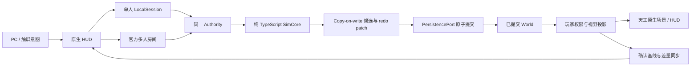

# 基础架构落地说明

日期：2026-11-11。当前工作按用户最新指示收敛为“先快速完成基础功能，后续逐一落实”。这是基础开发版本，不是原策划全部内容完成或正式上线版本。

## 一、真实执行路径

SimCore 无 DOM、ForgeAX、Node I/O 或数据库依赖。单人和 Node 权威端直接使用同一套规则，不维护客户端的第二份战斗/经济裁定。

## 二、状态和执行顺序

世界包含 Header、actors、items、containers、cohorts、terrain、buildings、jobs、tasks、reservations、companions、vehicles、deaths、bindings、disasters、resources。身份是稳定字符串，位置以 1/256 地块整数记录；20 Hz 是目标固定模拟时钟。

普通 tick：灾害 → 载具 → 移动/战斗 → 生存 → 长工作 → NPC 规划与动作 → 建筑供能/占据 → 伙伴 → 演化与预留回收。日边界先提交新增账本，再分批合法安置；安置完成前不推进普通 tick。容量不足进入明确阻塞状态。暂停不产生离线时间或日增。

命令包含 actor、epoch、sequence、command id、参数和可选对象版本。房间身份来自服务端连接，不能只信任 payload。物品转移必须校验物品、源容器和目标容器版本。成功或合法身份的业务拒绝推进序列高水位；最近 256 个回执缓存支持重发，缓存淘汰后旧序列仍不能重做。不同玩家的回执命名空间隔离。

## 三、事务和持久化

所有规则操作先生成候选状态与 patch。持久化成功后才交换权威 World；写失败保留最后已提交状态、阻止继续模拟，并保留原批次以重试。丢失 ACK 时检查已提交批次，不再扣第二次材料。checkpoint 失败独立记录为压缩警告，已经成功提交的命令仍然成功。

- IndexedDB：worlds 与 commits 原子更新、head/epoch 检查、navigator.locks 单写者、redo 恢复与 checkpoint。
- MemoryStore：故障注入和官方会话房间，明确标为 `session-only`。
- SqliteStore：Node `node:sqlite`，WAL、同步 FULL、事务内 fencing/head 校验、日志回放和原子 checkpoint。实际子进程提交后不调用 close 直接退出，重新连接能恢复提交。
- Portable save：格式、版本、内容 hash、校验和、危险键与深层不变量检查；只接收单人存档，导入创建新 worldId。校验和用于损坏检测，不是签名或反作弊。

造化房间磁盘的持久化合同尚无证据。SQLite 只是可替换适配器，不代表云端持久化 Gate 已过。旧版本迁移暂采用明确拒绝策略。

## 四、基础功能与可扩展边界

|域|基础实现|后续主要扩展|
|---|---|---|
|人口|99 NPC / 10000 感染体、每日 +100 / +10000、稳定身份、真实落位、环境死亡账本|远距离群体迁移、完整升降档、百日实时性能|
|地形/声音|种子地貌、有限资源、路径/LOS、门墙声学、临时/永久灾害地形分离|细化水文、连续灾害、围城路径、漂流/救援|
|经济|重量/权限/版本、原物资转移、工时、供电、取消/中断/死亡、预留、实物任务奖励|生产链平衡、建造选址预览、拆除/施工接管|
|角色|33 技能白板、食水/疲劳、装备/弹药、HP 上限、永久死亡|完整伤势、全部技能使用循环、装备槽/装填与表现|
|NPC|可见/听见 Belief、性格、记忆、HTN 前置拆分、同规则动作、失败回滚|组织自治、任务协作、驯兽/控制自主发展、长期规划评估|
|科技/伙伴|39 研究定义、三侧基础武器、捕获/训练/改造/维护/预算、转交/接管基础|13 分支完整产出、高阶体、保留方案 UI、专业能力与生态|
|载具|真实底盘、槽位/载重、燃料、座位、驾驶资格、车载有限弹药|多底盘/炮位、碰撞、车辆毁损与完整改装流程|
|联机|官方宿主、4 永久席位、服务端裁定、可见性过滤、差量与回退、节流|真实四端同局、重连网络故障、在线长期世界与持续压测|
|表现|原生 Engine / frontend roots、正交场景、PC/触屏输入、可替换资产合同|《隔离区》参考的 2.5D 像素资产、动画、镜头、UI、美术与音效|

## 五、索引与性能原则

cohort 空间索引与库存索引均是派生缓存，不能成为存档真值。空间缓存绑定具体不可变表和 slots；不能只用 worldId，避免被失败候选或导入污染。库存索引支持写时复制与失效，回滚候选不会改变已提交库存。索引原型链有界合并，避免无限增长。

差量只在已经过滤的玩家投影上计算，包括新增/更新/移除；客户端确认 worldId/seq，服务端保留有限历史。缺基线/断线使用全快照，不能在错误基线上硬套差量。

100 日人口正确性实验通过；当前 100 日规模 tick 仍超出 50 ms 预算。后续应优先分摊全局扫描、needs 与 NPC 调度、投影/事务复制，而不是删人口或改变日增规则。

## 六、后续改资产的约束

`assets/presentation/visual-contract.ts` 固定目标为 2.5D 像素、正交投影、nearest 采样合同，参考名称为《隔离区》。资产定义包含逻辑 key、稳定 GUID、像素密度、帧大小、pivot、4/8 方向与动画片段。当前主题资产集为空，production 校验会阻止把占位包视为正式资产。

角色身份、血量、技能、碰撞、武器距离和存档不依赖图片大小或动画时长。之后替换角色、建筑和地块资源应只改官方资产导入、主题映射、渲染与表现代码，不需要迁移世界身份或重写规则。当前三维方块只是可删除的调试表示。
